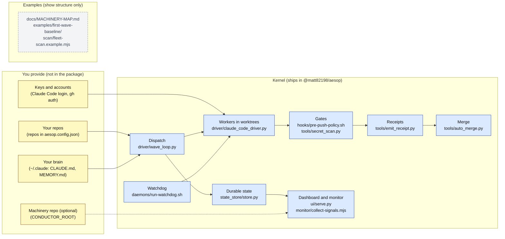

> **Contact policy.** I am not accepting acquisition offers, recruiter inquiries, or cold calls. Inquiries regarding licensing or commercial usage must go to matt82198@gmail.com. All other outreach will be ignored.

<p align="center">
  
</p>

<p align="center">
  <em>Crash-only multi-agent orchestration — restart IS recovery. Stateless workers, durable filesystem state, no central server to lose.</em>
</p>

<p align="center">
  <video width="400" controls><source src="https://raw.githubusercontent.com/matt82198/aesop/main/assets/clips/lens-fanout-haiku-pin.mp4" type="video/mp4"></video>
</p>

<p align="center">
  <a href="https://github.com/matt82198/aesop/actions/workflows/ci.yml"></a>
  <a href="https://www.npmjs.com/package/@matt82198/aesop"></a>
  <a href="https://www.npmjs.com/package/@matt82198/aesop"></a>
  <a href="LICENSE"></a>
</p>

> **Status notice:** Aesop Kernel is mid-way through a major event-based overhaul whose goal is restoring fully fail-closed hooks. The 0.9.x and 0.10.x minor releases may show some degradation versus earlier versions while that lands.

## What It Is

Aesop is a kernel. It is not a finished autonomous developer, and it does not know your repositories, rules, or accounts. It ships the parts that run the loop: dispatch, gates, receipts, merge, watchdog, durable state, and a dashboard. You fill in the rest.

An iteration counts only when it leaves receipts that a gate can check. A lane that reports success without a receipt a gate can verify has not passed. The receipt gate is still in measurement mode, so the hosted receipt check is not required yet ([docs/RECEIPT-GATE.md](./docs/RECEIPT-GATE.md)).

### System diagram

Blue boxes ship in the npm package. Yellow boxes are yours to provide. Grey dashed boxes are examples that show one way to structure the system.



### The kernel and what you fill in

The blue boxes are the kernel. They are fixed machinery that ships in the package and is the same for every repo: **Dispatch**, **Workers in worktrees**, **Gates**, **Receipts**, **Merge**, **Watchdog**, **Durable state**, and **Dashboard and monitor**. The gates are in `hooks/pre-push-policy.sh` and `tools/secret_scan.py`, and receipts are written by `tools/emit_receipt.py`.

The yellow boxes are yours, and you fill them in for your own repo:

- **Your repos** is the list of repos the fleet works on. Set it under `repos` in `aesop.config.json`, copied from `aesop.config.example.json`.
- **Your brain** is your rules, memory and brain-side hooks in `~/.claude`. Start from `CLAUDE-TEMPLATE.md` and `docs/MEMORY-TEMPLATE.md`. Your CLAUDE.md domain map, which names each domain and its rules, goes here too. The kernel does not ship one.
- **Machinery repo (optional)** is a directory of fleet state you own. Set it with `CONDUCTOR_ROOT` (see `daemons/conductor-root.sh`).
- **Keys and accounts** are your Claude Code login and `gh` auth. API keys are needed only for an API backend (`aesop.config.example.json` `seats`, `driver/anthropic_transport.py`).

The diagram does not draw a box for lane briefs, tests or STATE.md, but the same split applies. Lane briefs and your tests and gate configuration live in your repo. STATE.md is your intent and phase record, and the kernel reads it in `driver/orchestrator_driver.py`. `LANE-CONTRACT.md` in this repo is one project's dispatch contract, an example rather than a template to copy as-is.

### What ships, what you define, what is an example

| Class | Piece | Where (path) | What it does for you |
|---|---|---|---|
| Ships | Dispatch loop | `driver/wave_loop.py` | Runs one wave through the AgentDriver backends: preflight, build, verify, repair rounds. |
| Ships | Worker driver | `driver/claude_code_driver.py` | Runs a coding agent in a worktree. Other backends sit beside it in `driver/`. |
| Ships | Gates and pre-push policy | `hooks/pre-push-policy.sh` | Runs the push-time checks. The CLI copies it into `.git/hooks`. |
| Ships | Secret scan | `tools/secret_scan.py` | Blocks a push when staged files contain secrets. |
| Ships | Receipts | `tools/emit_receipt.py` | Signs a record of which local checks ran, for a gate to read. |
| Ships | Merge | `tools/auto_merge.py` | Merges green PRs in batches and fixes conflicts by default. Uses `gh`. |
| Ships | Watchdog and self-heal | `daemons/run-watchdog.sh`, `daemons/selfheal.sh` | Backs up and scans fleet work on a timer, honors the halt switch, and restarts stale daemons. |
| Ships | Durable state | `state_store/store.py` | Event-sourced SQLite (WAL) store. |
| Ships | Dashboard | `ui/serve.py`, `ui/web/dist/index.html` | Live fleet view. `npx @matt82198/aesop dash --demo` runs with no keys. |
| Ships | Monitor and MCP server | `monitor/collect-signals.mjs`, `mcp/server.mjs` | Collects health signals. The MCP server is read-only. |
| Ships | Skills | `skills/power/SKILL.md`, `skills/buildsystem/SKILL.md` | The CLI installs them into `~/.claude/skills/` unless you pass `--no-skills`. |
| Ships | Brain templates | `CLAUDE-TEMPLATE.md`, `docs/MEMORY-TEMPLATE.md` | Starting shape for your own CLAUDE.md and memory index. |
| Ships | CI templates | `templates/ci/ci-hosted.yml` | Starting workflows. Pick a mode with `npx @matt82198/aesop init --ci-mode`. |
| Ships | Claude Code hooks | `hooks/claude/force-model-policy.mjs` (plus two more) | Ship as files. Wiring them into your Claude Code settings is yours. |
| Ships | Config example | `aesop.config.example.json` | Example `aesop.config.json` to copy and edit. |
| You define | Repositories | `aesop.config.example.json` (`repos`) | The repos the fleet works on. The example uses placeholders. |
| You define | Brain | `~/.claude` (`brain_root`, see `docs/CONFIGURE.md`) | Your rules, memory, and brain-side hooks. Not in the package. |
| You define | Machinery repo (optional) | `daemons/conductor-root.sh` (`CONDUCTOR_ROOT`) | A directory of fleet state that you own. Set it explicitly. |
| You define | Keys and accounts | `aesop.config.example.json` (`seats`), `driver/anthropic_transport.py` | Claude Code login, `gh` auth, and API keys only if you use an API backend. |
| You define | Domain map | `CLAUDE-TEMPLATE.md` | Your project map and per-domain rules. |
| You define | Brain-side hooks | `~/.claude/hooks/` (not in this repo) | Hooks for your own environment. The kernel does not ship them. |
| Example | Aesop's own root CLAUDE.md | `CLAUDE.md` | One layout for a domain map. Not in the package. |
| Example | Machinery map | `docs/MACHINERY-MAP.md` | Maps this repo's gates and daemons. It does not describe your setup. |
| Example | First-wave replay | `examples/first-wave-baseline/` | A recorded wave to study. Not in the package. |
| Example | Scanner template | `scan/fleet-scan.example.mjs` | An IOC scanner to copy and configure. |
| Example | Lane contract | `LANE-CONTRACT.md` | One project's dispatch contract. Not in the package. |
| Example | This repo's metrics and tests | `stats.json`, `tests/` | Counts and suites for Aesop itself. Not in the package. |

### Fill in the gaps

1. **Install the kernel.** `npx @matt82198/aesop my-fleet --name "api" --repos "/path/to/repo"`, then `npx @matt82198/aesop doctor` to see what is still missing.
2. **Point it at your repos.** Copy `aesop.config.example.json` to `aesop.config.json` and set `repos`. Field reference: [docs/CONFIGURE.md](./docs/CONFIGURE.md).
3. **Write your brain.** Copy `CLAUDE-TEMPLATE.md` to `~/.claude/CLAUDE.md` and edit it. Add a `MEMORY.md` built from `docs/MEMORY-TEMPLATE.md`. `/power` reads both.
4. **Name a machinery repo (optional).** Set `CONDUCTOR_ROOT` to a directory you own. Do not rely on the default. Some daemons derive a sibling `conductor3` directory when it is unset (`daemons/run-watchdog.sh`, line 496).
5. **Provide keys and accounts.** Run `gh auth login` for merges and sign in to Claude Code for workers. Add API keys only if you use an API backend.
6. **Run one wave.** `npx @matt82198/aesop watch`, then `/power`, then `/buildsystem`. [docs/FIRST-WAVE.md](./docs/FIRST-WAVE.md) walks through it.

## Background

**Aesop Kernel is a multi-agent orchestration kernel for autonomous software development.** A kernel, not a harness: it owns the boundary between the model and your codebase, enforces one invariant (fail-closed verification), and refuses what it cannot verify rather than steering the model. It runs fleets of LLM coding agents across ranked backlog items, verifies their output locally, and ships merge-ready code to CI. Crash-only by design: workers are stateless, state lives in git + SQLite + durable files, and restart is the only recovery path.

The design lineage spans 50 years: Unix kernel/user-space boundaries and fail-closed composable tools (1975), through crash-only software (Candea & Fox, 2003), to the agentic loop — the Ralph technique of running a coding agent in a tight reconciliation loop (2025). Aesop Kernel implements this: the wave cycle is a reconciliation controller; STATE.md + BUILDLOG.md are the durable event log; workers are supervised processes; crashes trigger re-reads from disk.

**Self-learning.** The kernel dogfoods itself (it builds itself via its own /buildsystem loop) and categorizes failure modes into enforcement: the gate-escape-resolver skill turns CI failures into postmortems and audit cycles extract repeated issues and wire them into verification gates.

**Due to anthropics recent changes preventing clean implementations of fail closed hooks, the project is currently not fully firing all hooks, this is actively being solved, and v0.9.1 shipped fixes for some of the largest issues.**

## Credibility: The Trap Tests

Aesop Kernel does not trust itself. Every agent writes code claiming to be correct, and [the trap tests](./tests/test_traps.py) deliberately reproduce patterns of agent deception:

- **Fake-green trap**: Tests that skip real validation (caught incident #464: playwright browser-proofs reported green without actually running). Prevention: counts are computed live from git ls-files (no stored artifact to drift) and `python tools/verify_test_suite_count.py --check` verifies the CI shard matrix actually covers every tracked test file.
- **Gate-activation trap**: Forbidden flags (--admin, --no-verify, --auto) in dispatch templates (caught 7+ incidents). Pre-push secret scan blocks leaks with fail-closed exit on read errors.
- **Doc-invented trap**: Documentation claims not backed by facts (caught hallucinated 0.3.0 CHANGELOG entries). Prevention: statistics gate verifies README matches git.
- **Test-pollution trap**: Test state leaking across isolation boundaries (caught 6 incidents including sys.modules mock pollution). Prevention: all tests use isolated temp directories and subprocess cwd= isolation.
- **CI-drift trap**: Workflow state out of sync (caught #450: pytest missing from main-full.yml). Prevention: YAML validation and required-tool assertion.

**See docs/INCIDENTS.md for the 41-incident log backing each trap class.**

## Credibility: The Cancelled Architecture

A measured design decision, not a feature.

In wave-11, a hierarchical dispatch architecture was built: orchestrator → Sonnet specialists → Haiku fleets. A/B testing measured it as **4.3x weighted cost** (`docs/ab-cost-dataset.md`) producing **identical quality** (100% test pass <!-- metrics-verified: docs/ab-cost-dataset.md -->, zero repair rounds) on the same fixture. The architecture was cancelled on 2026-07-14. `docs/archive/spikes/tiered-cognition/` keeps it for reference; nothing is wired into live settings.

**The lesson:** flat Haiku-first dispatch is not a limitation—it is the measured optimum for this problem. Architectural changes require A/B proof or they stay off.

## Quick Try (2 min, no API keys)

Node.js >= 18, git, and Python 3.11+ (`npm run test:all` invokes Python test runners; `test:sh` also needs bash). No API keys needed.

### Dependencies (what is literally true)

- **npm runtime dependencies: none.** The root `package.json` has no `dependencies` key. Its only entry is the devDependency `@playwright/test`. `mcp/package.json` declares `"dependencies": {}`. The Node runtime code in `bin/`, `daemons/`, `monitor/`, `dash/`, `mcp/`, `hooks/claude/` and `scan/` imports only Node built-in modules.
- **Python**: the tooling under `tools/` and `daemons/` is mostly standard library. The non-stdlib imports are PyYAML (CI workflow linters), `cryptography` (receipt signing, with an HMAC fallback when absent), `playwright` (browser verification scripts), `opentelemetry` (optional, import-guarded telemetry sink), `anthropic` (bench API runner), and `pyflakes` (imported by `tools/pyflakes_gate.py`). CI also installs `pytest` to run `tests/`; no file under `tools/` or `daemons/` imports it. The declared list is in [`pyproject.toml`](./pyproject.toml).
- **CI floor**: the lowest Python version any workflow in `.github/workflows/` runs is 3.11.

```bash
git clone https://github.com/matt82198/aesop.git && cd aesop
npm install && npm run test:all             # Run full test suite
npx . --help                                # See CLI
```

Explore the CLI, verify the test infrastructure, and study [examples/first-wave-baseline](./examples/first-wave-baseline) — a replay kit of a complete autonomous wave cycle.

## Full Setup (LLM orchestration)

To run the actual multi-agent orchestration loop you need:

- **Claude Code CLI** (or another supported backend) with a valid API key
- **Python 3.11+** for guardrails, secret scanning, and the dashboard
- **Bash 4+** (or Git Bash on Windows) for daemon scripts

```bash
# Scaffolds the fleet AND installs /power, /buildsystem, /fleet, /dashboard,
# /healthcheck into ~/.claude/skills/ — the only path Claude Code scans.
# Add --install-deps to also run npm install and pip install -r requirements.txt.
npx @matt82198/aesop my-fleet --name "api" --repos "/path/to/repo" --install-deps
cd my-fleet

# Restart Claude Code — skills are enumerated at startup.
npx @matt82198/aesop doctor   # Confirms skills, hooks, config, and interpreters
```

Existing skills of yours are never clobbered: an installed skill that differs
from the shipped one is preserved and reported, and `--force` overwrites it.
Use `--no-skills` to scaffold without touching `~/.claude/`.

See the Learn More section for setup and architecture guides.

## How It Works

**Three layers:** An orchestrator (Opus/Fable, main thread) dispatches parallel Haiku workers in isolated worktrees—1/5 the per-token cost of Opus. Durable state lives in SQLite WAL + git-committed files (STATE.md, BUILDLOG.md). On crash, the orchestrator re-reads from disk. No special recovery.

**Verification gates:** Fail-closed secret scan (pre-push), re-run of the exact CI gate (no mock), adversarial review (default-on). These are not optional best-practices—they are the default architecture.

**Observable machinery:** Heartbeats detect stalls; watchdog auto-restarts; every decision is readable in logs and git history. See [docs/ARCHITECTURE.md](./docs/ARCHITECTURE.md) for the full picture.

## Known Limitations

- **Benchmark is curated, not sampled.** The 39-task judgment set (Haiku vs Sonnet vs Opus) scored 39/39 on all tiers, hitting the pre-declared ceiling rule (discrimination failure). It measures a sufficiency floor for seam-level tasks, not tier equivalence. See [bench/METHODOLOGY.md](./bench/METHODOLOGY.md).
- **Seam-level only.** This repo's agents operate within code review, test triage, severity assessment, and orchestration seams. Frontier reasoning (architecture redesign, novel algorithms) is out of scope.
- **MCP server is read-only by design.** State-store projections reflect the last successful run state. Real-time multi-agent coordination is not implemented.

## Learn More

- **[docs/INSTALL.md](./docs/INSTALL.md)** — Setup and first wave
- **[docs/FIRST-WAVE.md](./docs/FIRST-WAVE.md)** — Walkthrough of a complete autonomous wave cycle
- **[docs/MICROKERNEL.md](./docs/MICROKERNEL.md)** — Two-seat architecture (worker + orchestrator), model swapping
- **[docs/HOW-THE-LOOP-WORKS.md](./docs/HOW-THE-LOOP-WORKS.md)** — Concrete walkthrough of one wave cycle
- **[THE-AESOP-HYPOTHESIS.md](./docs/THE-AESOP-HYPOTHESIS.md)** — Design philosophy, trade-offs, and why crash-only
- **[DISPATCH-MODEL.md](./docs/DISPATCH-MODEL.md)** — Cost analysis, Haiku sufficiency, scaling properties
- **[docs/how-i-built-aesop.md](./docs/how-i-built-aesop.md)** — Technical narrative of the orchestration design
- **[CARDINAL-RULES.md](./docs/CARDINAL-RULES.md)** — 10 foundational principles for safe autonomous code
- **[autonomous-swe.md](./docs/autonomous-swe.md)** — What "autonomous" means and doesn't. Honest limits.
- **[docs/INCIDENTS.md](./docs/INCIDENTS.md)** — All 98 incidents: fake-green, gate-activation, test-pollution, stalls, conflicts, flakes, CI drift, hallucinations.
- **[RELEASE-NOTES.md](./RELEASE-NOTES.md)** — Release notes for the latest version (full per-PR list in [CHANGELOG.md](./CHANGELOG.md)).

## Contributing

Aesop Kernel is **source-available** under the PolyForm Noncommercial License 1.0.0. Patches and contributions are welcome.

- **Issues and bug reports** — tell us what's broken or confusing.
- **Discussion and ideas** — feature requests, design critiques, use-case questions.
- **Code contributions** — fork, commit, and open a PR; we'll review and merge.

See [CONTRIBUTING.md](./CONTRIBUTING.md) for details. The repo develops itself via its own /buildsystem loop.

## License

Aesop Kernel is licensed under the **[PolyForm Noncommercial License 1.0.0](./LICENSE)** from 0.8.0 forward: free for personal, research, and noncommercial use; commercial use is prohibited without a separate agreement.

Versions **0.7.2 and earlier** (released as Aesop) were under the MIT License and remain available under those terms — the relicense is not retroactive.

For commercial licensing, contact the author (Matt Culliton).

Copyright 2026 Matt Culliton.

## Citing

If you use Aesop Kernel, please cite it using the metadata in [CITATION.cff](./CITATION.cff) (GitHub
renders a "Cite this repository" button from this file). It also lists the preferred research
citation, *The Receipts Loop* (manuscript draft, arXiv submission pending).

## References

- [Anthropic Claude API docs](https://docs.anthropic.com)
- [Claude Code CLI](https://github.com/anthropics/claude-code)
- [Git docs](https://git-scm.com/doc)

---

**Aesop Kernel**: Autonomous developer for any repository, built by itself. May your kernel be honest and your workers swift.
