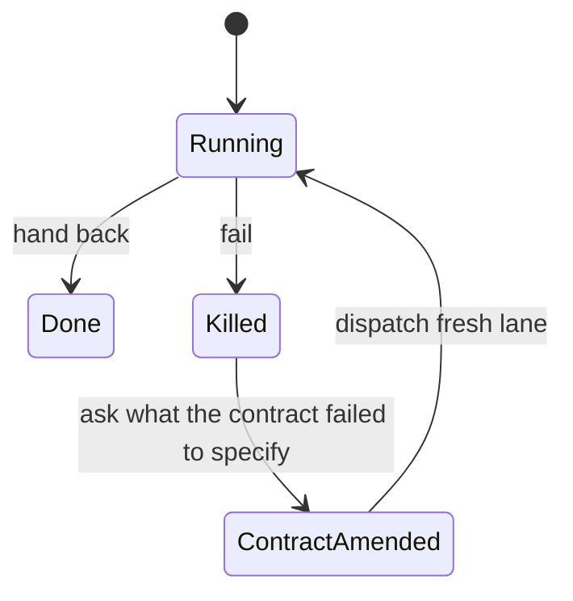

# Crash-only operation

Aesop handles a crash by starting over from disk, and it does so on purpose. Restart is
the recovery path. Workers keep no state of their own. Nothing gets repaired in place.

This page shows what the repository does to support that model, and where the model
stops. Each claim cites its source as `path:line`.

## The model in brief

Workers are stateless. Their state lives outside them, in durable stores. Restart is the
only recovery path. The project's own summary says so in one line: "restart IS
recovery" (source: `README.md:8`). The background section states the same rule at
greater length, naming git, SQLite, and durable files as the places state lives
(source: `README.md:94`).

## Lanes are killed, not repaired

A lane is one stateless agent run under a stage contract. For what a contract contains,
see [stage lanes](stage-lanes.md).

When a lane fails, the orchestrator sends it no correction. Nothing is patched. The
contract says the lane is killed, and that ends that agent run. The question that
follows is a narrow one: what did the contract fail to specify? The orchestrator
answers it by amending the contract and dispatching a fresh lane
(source: `LANE-CONTRACT.md:5-9`). Failure changes the contract, never the running agent.

`Done` is the hand-back a stage returns once its output artifact exists
(source: `docs/STAGE-CONTRACTS.md:170`). `Killed` is the path a failed lane takes
(source: `LANE-CONTRACT.md:5`). The diagram covers lanes only.

## Daemons restart from disk

Two shell daemons keep the background machinery running. Neither needs a person at the
keyboard.

The watchdog runs a backup and scan cycle every 150 seconds. The sleep that paces the
normal cycle sits at `daemons/run-watchdog.sh:467`. The file's header describes the same
cycle (source: `daemons/run-watchdog.sh:3`). While halted, the loop takes a separate
sleep at `daemons/run-watchdog.sh:438` (the sleep while halted) and skips the cycle body.

The halt switch pauses the watchdog. If a box-wide or per-checkout halt sentinel exists,
each cycle logs `HALTED` and skips its work. Halt status that cannot be read also skips
the cycle. Stopping on an unreadable status is the fail-closed choice. Read the header
for the exact wording (source: `daemons/run-watchdog.sh:9-12`).

Self-heal watches the watchdog's heartbeat. When that heartbeat goes stale, self-heal
starts the watchdog again in the background
(source: `daemons/selfheal.sh:178`, `daemons/selfheal.sh:189`).

Self-heal yields to the halt switch. A halted watchdog writes no heartbeat. So it always
looks stale. Respawning it would only leak processes. Self-heal therefore leaves it alone
while the halt sentinel is present (source: `daemons/selfheal.sh:179-183`).

The restart rule is narrower than "restart everything." A stale heartbeat triggers a
restart only when no halt is in effect.

## State survives a crash

Restart is safe only because the state it reads is durable. Two places hold that state.

The event store runs SQLite in WAL mode. Many readers can share one file, and writers
are serialized (source: `state_store/store.py:5`).

Git holds the committed work (source: `README.md:94`). On every cycle, the watchdog backs
up both committed and uncommitted fleet work (source: `daemons/run-watchdog.sh:3`).

## A resume proof exists and runs offline

The repository includes a demo that tests the resume claim. It runs the wave engine once
without interruption. That run is the control. It then runs the same wave and stops it at a
phase boundary. A second operator resumes it. The claim under test is that
the control and the resumed run end in the same terminal state (source:
`tools/handoff_proof.py:4`, `tools/handoff_proof.py:9-13`).

The demo needs no API keys. The source says "offline" (source:
`tools/handoff_proof.py:4`). The certificate it writes carries the date of the run that
produced it (source: `docs/HANDOFF-CERTIFICATE.md:3`). This page does not treat that
certificate as a current result.

## What this page does not claim

- It does not describe stall detection for individual lanes. The cited sources define
  failure, not stall. The watchdog and self-heal logic covers daemons, not lane runs.
- It does not claim that a killed lane's partial work is recovered on its own. The
  contract replaces the failed lane with a fresh one (source: `LANE-CONTRACT.md:5-9`).
- It does not claim that the resume proof covers any environment beyond the offline demo
  it describes.

## See also

- [Why crash-only](../WHY-CRASH-ONLY.md): a longer essay on the same idea. Nothing on
  this page is drawn from it.
