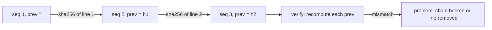

# Event store (hash-chained log)

An event store is an append-only JSON Lines log for one project. Every line is one event.
Each line also records `prev`, the SHA-256 of the previous line's bytes. A reader can
recompute the chain and find an edited, removed or reordered line. This makes the log
**tamper-evident under `verify`**. It does not make the log tamper-proof: `verify` checks
the store against itself and has no outside anchor (see [Limits](#limits)).

Per-project layout and the registry that maps projects to stores are in
[Per-project stores](per-project-stores.md). Commands for checking a store are in
[Verify an event store](../guides/verify-event-store.md).

Sources: all `tools/event_store/` paths below are on `origin/main`. Line numbers are from that tree.

## On-disk layout

A store is a directory with this shape:

```text
<store>/
  store.json            {"project": "<name>", "schema": 2}
  events/YYYY-MM-DD.jsonl   one event per line, one file per UTC day
```

- `store.json` must name a `project` and a `schema` of `1` or `2`. Anything else is refused.
  (`tools/event_store/store.py:38-53`)
- Day files match `^\d{4}-\d{2}-\d{2}\.jsonl$` and are read in sorted order.
  (`tools/event_store/store.py:16`, `:66-69`)
- Schema 2 is the layout for new stores. One chain spans every day file, and `seq` counts
  across the whole store. (`tools/event_store/store.py:3-5`)
- Schema 1 is the frozen layout written by the earlier single log. Each day file restarts
  the chain at `prev` `""`. A directory with day files and no `store.json` is opened as
  read-only schema 1. (`tools/event_store/store.py:7-8`, `:39-45`)

## Event shape

Every schema 2 event has exactly these keys:

| Key | Meaning |
|---|---|
| `v` | Schema version, always `2` for new events |
| `ts` | UTC timestamp, `YYYY-MM-DDTHH:MM:SSZ` |
| `seq` | Position in the whole store, starting at 1 |
| `kind` | Event kind, for example `note`, `ruling`, `checkpoint` |
| `actor` | Who wrote it |
| `session` | Session id, empty when unknown |
| `text` | Free text |
| `refs` | Object of string references, for example `goal`, `pr` |
| `prev` | SHA-256 of the previous line's bytes; `""` for the first event |

The key list is defined at `tools/event_store/store.py:17` (`V2_KEYS`). Lines are written
with sorted keys, compact separators and UTF-8 (`tools/event_store/store.py:28-30`).

> `V2_KEYS` is defined but `verify` does not read it. Verification checks `v`, `seq` and
> `prev`, not the full key set. See [Limits](#limits).

## Chain



Each `prev` is the hash of the exact bytes of the line before it, with no trailing newline
(`tools/event_store/store.py:24-25`, `:106`). The first event's `prev` is `""`
(`tools/event_store/store.py:106`).

## How an append works

`Store.append` (`tools/event_store/store.py:91-111`) does the following in order:

1. Refuses a read-only v1 store (`store.py:92-94`).
2. Refuses any store whose schema is not 2 (`store.py:95-97`).
3. Refuses a `ts` whose day is earlier than the latest day file (`store.py:101-102`).
4. Sets `seq` to the store's last `seq` plus 1 (`store.py:103-104`).
5. Sets `prev` to the hash of the store's last line, or `""` (`store.py:106`).
6. Appends one line to `events/<ts day>.jsonl` (`store.py:107-110`).

The command-line front end is `tools/event_store/cli.py`, subcommand `append`
(`cli.py:64-97`). It refuses before writing when:

- there is no `--project` and no `--ref goal=G<n>` to route by (`cli.py:70-75`);
- the event is a `ruling` with no `goal` ref (`cli.py:79-80`);
- a ref key encodes a repo, such as `demo_pr_12` (`cli.py:20`, `:34-36`);
- the store at the registry path belongs to a different project (single-writer check,
  `cli.py:86-88`).

`session` defaults to the `CLAUDE_SESSION_ID` environment variable (`cli.py:157`).

Exit codes are documented at `cli.py:3-4`: `0` ok, `1` failure, `2` refused or usage error.

### Git commit on append

If the store directory is its own git worktree, `append` stages everything in that worktree
with `git add -A -- .` and commits it with the message `event <seq> <kind>`
(`cli.py:41-61`, `cli.py:94`). It never pushes; only `add` and `commit` are run
(`cli.py:53`). If the store directory is not its own repository, nothing is committed
(`cli.py:46-47`).

## What `verify` checks

`Store.verify` (`tools/event_store/store.py:113-145`) returns a list of problems. Empty means
intact. It checks each line of each day file, in order:

| Check | Source |
|---|---|
| Line parses as JSON; otherwise `unparseable line` | `store.py:124-129` |
| `prev` equals the SHA-256 of the previous line's bytes; otherwise `prev mismatch (chain broken or earlier line removed)` | `store.py:130-133` |
| Schema 2 only: `v` equals `2` | `store.py:135-137` |
| Schema 2 only: `seq` is exactly one more than the previous `seq` across the store | `store.py:138-139` |
| Schema 1 only: `seq` is an increasing integer; the chain restarts at each day file | `store.py:120-121`, `:140-141` |

The CLI prints each problem as `<path>: <problem>`, then `verify: N problem(s)`, and exits
`1` when N is above zero (`tools/event_store/cli.py:100-119`).

`Store.verify` reads files under the store directory and nothing else. It reads no git history
and no signature. The CLI consults the registry only for `--project` (`cli.py:104-109`).

## Append-only guard

`tools/event_store/guard/events_append_only.sh` is a pre-commit hook. It refuses a commit
that deletes, renames, copies or rewrites an existing event line in `events/*.jsonl`
(`events_append_only.sh:2-4`, `:23-32`). Added files and appended lines pass.

- The guard reads the staged diff with `git diff --cached` and refuses if git cannot
  report it (`events_append_only.sh:12-20`).
- `tools/event_store/init.py` installs the guard per store worktree, under the git common
  directory, and points that worktree's `core.hooksPath` at it (`init.py:17-20`, `:96-112`).

The guard was run against a scratch repository for this page. It rejected a rewrite with exit
`1`. It passed a pure append with exit `0`. The output is in the
[verify guide](../guides/verify-event-store.md#step-5-check-the-append-only-guard).

## Limits

- **Tamper-evident, not tamper-proof.** `verify` recomputes `prev` from the bytes on disk.
  Anyone who can write the store can rewrite a suffix of the log and recompute every `prev`
  after the edit. `verify` then passes, because it has no record outside the store to compare
  against (`store.py:113-145`).
- **The last line is not anchored.** No later line stores the hash of the final line, so
  editing only the final line passes `verify`. Observed: a scratch copy with the last event's
  text changed printed `verify: 0 problem(s)` and exited `0`
  ([verify guide, step 4](../guides/verify-event-store.md#step-4-see-a-broken-chain)).
- **Key set not checked.** `V2_KEYS` (`store.py:17`) is not used by `verify`.
- **No signatures.** `store.py` imports only `hashlib`, `json`, `re`, `time` and `pathlib`
  (`store.py:10-14`). Signing is outside this module.
- **Guard is local.** The pre-commit guard runs only in worktrees where it is installed.
  Nothing in this module makes a remote refuse a rewrite.
