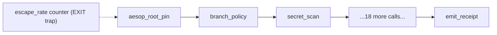

# Gates and hooks

A gate is a check that can stop work. A hook is the place a gate is wired in. This page explains the three
places aesop puts them, what each one actually stops, and what it cannot stop. The per-gate list is in
[Gate reference](../reference/gates.md); installing the git hook is in [Install the pre-push hook](../guides/install-hook.md).

## The short version

- One shipped local gate chain: `hooks/pre-push-policy.sh`, which git runs before every push.
- Three shipped Claude Code hook files under `hooks/claude/`. They are files; wiring them into a Claude Code
  `settings.json` is your job.
- One server-side layer that is not a file at all: GitHub branch protection. The local hook is a convenience;
  the server is what makes a rule binding (`docs/HOOK-INSTALL.md:28-30`).
- Some hooks the project's author runs are not in this repository. See [Claim binding](claim-binding.md) and
  [Provenance](../PROVENANCE.md).

## Layer 1: the pre-push chain

`hooks/pre-push-policy.sh` defines 23 `check_*` functions. <!-- grep -cE '^check_[a-z_]+\(\)' hooks/pre-push-policy.sh -> 23 -->
`main()` runs them in a fixed order (`hooks/pre-push-policy.sh:3830`), and the order ends with the receipt gate:
`check_emit_receipt` is the last call (`hooks/pre-push-policy.sh:4058`). The order is spelled out in
[Gate reference](../reference/gates.md); this is the shape of it.

Arithmetic worth knowing before you read the reference: 23 functions, of which two never block. `check_gate_tamper`
only prints a banner and always returns 0 (`hooks/pre-push-policy.sh:357-377`), and `check_escape_rate` is an
observability counter that "never changes the push outcome" (`hooks/pre-push-policy.sh:1944`). The other 21 can
block a push. <!-- 23 total minus check_gate_tamper and check_escape_rate = 21 -->

### What makes the chain hard to weaken

Three design choices do most of the work.

1. **Gates are judged by the base copy.** Every gate script runs from the trunk's `tools/`, never from the branch
   being pushed, so a branch that weakens a gate cannot judge its own push (`hooks/pre-push-policy.sh:260-265`).
   When a push edits a gate file, a loud banner says so (`hooks/pre-push-policy.sh:374`).
2. **A missing gate script blocks.** If `tools/` exists but one gate's script is gone, the push is blocked. The
   gate is skipped only when `tools/` is absent as a whole, which is the case of a repo that carries the hook
   but no aesop toolchain (`hooks/pre-push-policy.sh:179-198`; `hooks/CLAUDE.md:62-65`). This matters if you
   adopt the hook without the rest of the repo: most of the chain then does nothing, and the audit log records
   `*_skipped_no_aesop_tools` events for it.
3. **Every block is written to an audit log.** `log_block` appends a JSON line to `state/SECURITY-AUDIT.log`
   (`hooks/pre-push-policy.sh:1887-1902`). Each line carries the SHA-256 of the previous line, starting from
   `GENESIS`, and `bash hooks/pre-push-policy.sh --verify-audit-log` checks the chain
   (`hooks/pre-push-policy.sh:440,482,3836`). The chain detects edits and tail truncation by someone who does
   not also rewrite the sidecar; it is not protection against an attacker with write access to the machine
   (`docs/HOOK-INSTALL.md:138`).

### The gates, grouped by what they protect

| Group | Gates | What they stop |
|---|---|---|
| Where you push | `aesop_root_pin`, `branch_policy` | Pushes to `main` or `master` (`hooks/pre-push-policy.sh:591`), and gates pointed at a different tree than the one being pushed (`:3856-3859`) |
| What you push | `secret_scan`, `import_resolution`, `conflict_markers`, `symbol_survival` | Credentials, unresolvable imports, literal conflict markers, symbols a merge commit silently dropped |
| Repo hygiene | `tracker_guard`, `claudemd_sync`, `gen_tool_index`, `metrics`, `claudemd_headroom`, `test_suite_count`, `generated_paths`, `generated_regen` | Doc, index and generated-file drift; unverified numeric claims; CI shards that drop tests |
| Ratchets | `pyflakes_ratchet`, `inprocess_http_timeout`, `subprocess_guard_ratchet`, `encoding_lint`, `test_coverage`, `linux_shape` | New lint findings above a committed baseline; test files no CI job runs; Windows-only red |
| Evidence | `emit_receipt` | A push whose test matrix came back red, or whose result cannot be read |
| Observability | `gate_tamper`, `escape_rate` | Nothing. They make gate edits and skip counts visible |

The receipt gate is the end of the chain by design. It runs the test matrix only after every cheaper gate has
passed, so the receipt is bound to a tree the hook has already inspected (`hooks/pre-push-policy.sh:2363-2380`).
The receipt gate's status and emission rules are in [Receipt gate](../RECEIPT-GATE.md).

## Layer 2: Claude Code hooks

Three hook files ship under `hooks/claude/` next to their tests:

| File | Event and matcher | What it does | Logged escape token |
|---|---|---|---|
| `force-model-policy.mjs` | PreToolUse, `Agent\|Task` | Rewrites a subagent dispatch whose `model` is absent or non-compliant to the policy model (default `haiku`) | `[[ALLOW-NON-HAIKU]]` |
| `no-heredoc-file-authoring.mjs` | PreToolUse, `Bash` | Denies a Bash command that authors a file through a heredoc | `[[ALLOW-HEREDOC-WRITE]]` |
| `no-scrollback-as-record.mjs` | PreToolUse, `Bash\|Read\|Grep\|Glob` | Denies reading session transcripts as if they were the system of record | `[[ALLOW-TRANSCRIPT-READ]]` |

Cites: `hooks/claude/force-model-policy.mjs:7-12,39,145`; `hooks/claude/no-heredoc-file-authoring.mjs:4,32,39`;
`hooks/claude/no-scrollback-as-record.mjs:27,39,46`; matchers in `hooks/CLAUDE.md:101,119-120`.

Points that are easy to get wrong:

- **The model policy is configurable.** The hook enforces `haiku` unless `aesop.config.json` sets
  `cardinal_rules.subagent_model` (`hooks/claude/force-model-policy.mjs:9,75-82`). The "subagents are always
  Haiku" rule in [Cardinal rules](../CARDINAL-RULES.md) is the default, not a hard-coded value.
- **It rewrites, it does not block.** A non-compliant dispatch goes through with its model replaced via
  `updatedInput` (`hooks/claude/force-model-policy.mjs:162-172`).
- **Failure behaviour differs per hook.** `force-model-policy.mjs` answers `deny` on empty, malformed or timed-out
  input (`hooks/claude/force-model-policy.mjs:129-137,178`). The other two answer `allow` on input they cannot
  parse (`hooks/claude/no-heredoc-file-authoring.mjs:124`; `hooks/claude/no-scrollback-as-record.mjs:169`).
  Treat "do the hooks fail closed" as a per-file question, not a property of the set.
- **Escape tokens are visible.** The token lives in the prompt or command, so every use is in the transcript, and
  each hook appends a record to a log file.
- **You wire them yourself.** Shipping the file does not register it. The registration block is in
  [Install the pre-push hook](../guides/install-hook.md).

Tests that run on this tree: 13 for the model policy, 19 and 34 for the other two.
<!-- node --import ./tests/helpers/isolated-env.mjs --test tests/force-model-policy.test.mjs -> tests 13, pass 13 -->
<!-- node hooks/claude/no-heredoc-file-authoring.test.mjs -> 19 passed, 0 failed -->
<!-- node hooks/claude/no-scrollback-as-record.test.mjs -> 34 passed, 0 failed -->

## Layer 3: server-side enforcement

A git hook runs on the pusher's machine, so the pusher can skip it with `git push --no-verify`
(`docs/HOOK-INSTALL.md:28`). What a skipped hook cannot undo is a rule the server enforces. For aesop that means
GitHub branch protection with required status checks.

The required checks are not stored in a workflow file or a hook. `tools/required-checks.json` declares the intent
(seven contexts: `ci (0)` to `ci (3)`, `windows`, `pr-footprint-gate`, `pr-symbol-survival`;
`tools/required-checks.json:6-12`), and `tools/required_checks_gate.py` fails when the declared set and the live
branch-protection set differ in either direction (`tools/required_checks_gate.py:1-24`).
<!-- node -e "console.log(require('./tools/required-checks.json').required_contexts.length)" -> 7 -->

> A fork does not inherit this. Branch protection and required checks are settings on the GitHub repository, and
> `tools/required-checks.json` is only a record of what the original repository set. A fork starts with no
> required checks until its owner configures them. See [Install the pre-push hook](../guides/install-hook.md).

The receipt check is deliberately not in that set. `docs/RECEIPT-GATE.md:3-4` states the hosted `verify-receipt`
check is not required while the receipt gate is in its measurement period, and `.github/workflows/verify-receipt.yml:23`
repeats it. That is why this page does not say receipts replace other CI.

## Limits

- The local hook is a convenience defense. A pusher can bypass it, and it is not cryptographic protection
  (`docs/HOOK-INSTALL.md:28`; `hooks/CLAUDE.md:135`).
- The project's README says that, because of changes in how Claude Code handles hooks, "the project is currently
  not fully firing all hooks" (`README.md:100`). Do not assume a Claude Code hook fires in your client version;
  test it. The pre-push chain is plain git and does not depend on that.
- The "blocks when it cannot judge" behaviour described above is scoped to the shipped pre-push chain and to
  `force-model-policy.mjs`. It is not a statement about hooks that are not in this repository.
- Some enforcement the author relies on, such as the lane-dispatch hooks and claim binding, lives in a private
  repository and is not shipped here (`docs/PROVENANCE.md:24`; [Claim binding](claim-binding.md)).
- The audit log is local, git-ignored state. Centralize it if you need real auditability (`docs/HOOK-INSTALL.md:138`).
