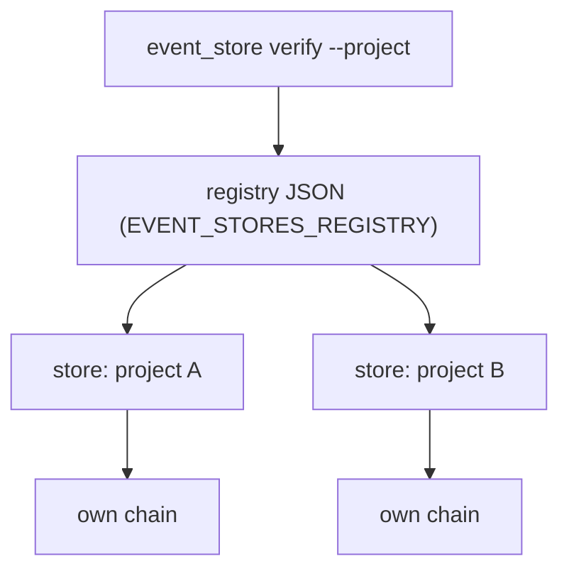

# Per-project stores

Status: **partly built.** The repository already contains the store module, the registry, the
`append`, `verify` and `project` commands, the append-only guard, an initializer and a one-time
migration tool. This page does not claim the live cutover. That cutover would move existing
events into per-project stores and make them the only write path. Items marked *planned* are
described by the plan and are not confirmed in code.

Each project gets its own event store, with its own hash chain (see
[Event store](event-store.md)). A registry names the stores and says which project owns
which goals.

Sources: paths are on `origin/main`. Line numbers come from that tree.

## Why

One hash-chained log held every project's rulings, pull-request states and checkpoints.
As of 2026-10-22 (plan snapshot, not re-measured on this tree), 74 of its 256 events could
not be attributed to one project by any reference. The source is
`docs/plans/PER-PROJECT-EVENT-STORES.md:9-10`. Per-project stores let each project's events be
read on their own.

## What exists

| Piece | Where | Role |
|---|---|---|
| Store | `tools/event_store/store.py` | Append, load, verify one store |
| Registry | `tools/event_store/registry.py` | Maps project name to store path and goals |
| CLI | `tools/event_store/cli.py` | Subcommands `append`, `verify`, `project` |
| Projections | `tools/event_store/project.py` | Read-only views across stores |
| Initializer | `tools/event_store/init.py` | Creates a store on an orphan branch, with a worktree and the guard |
| Migration | `tools/event_store/migrate.py` | One-time split of a frozen single log into per-project stores |
| Guard | `tools/event_store/guard/events_append_only.sh` | Pre-commit refusal of rewrites |
| Tests | `tests/test_event_store_core.py`, `test_event_store_init.py`, `test_event_store_migrate.py`, `test_event_store_project.py` | Module tests |

The CLI registers three subcommands only: `append`, `verify` and `project`
(`tools/event_store/cli.py:152-172`). `init.py` and `migrate.py` each have their own entry
point and are run as scripts (see below).

## Registry

The registry is a JSON file. Its path is taken from the environment variable
`EVENT_STORES_REGISTRY` if set, otherwise `~/.claude/event-stores.json`
(`tools/event_store/registry.py:7`, `:15-19`).

The file must contain a `stores` object (`registry.py:28-29`). Each entry is keyed by project
name and has:

- `path`: the store directory. Missing `path` is refused (`registry.py:44-47`).
- `goals`: a list of goal ids such as `G2`. Used to route events that carry only a goal
  reference (`registry.py:33-41`).

```json
{
  "stores": {
    "project-a": {"path": "<store-dir-a>", "goals": ["G2"]},
    "project-b": {"path": "<store-dir-b>", "goals": ["G3"]}
  }
}
```

The placeholders are directories you create. The guide shows a full working example
([Verify an event store](../guides/verify-event-store.md)).



### Goal ids

A goal reference such as `G2.1` is reduced to its major id, `G2`, before lookup
(`registry.py:8`, `:33-41`). An event with `--ref goal=G2.1` and no `--project` is routed to the
project whose `goals` list contains `G2`. If no project lists that goal, the append is refused
(`cli.py:76-78`).

## Routing rules for `append`

- `--project <name>` names the store directly (`cli.py:70`).
- Without `--project`, the goal reference picks the store (`cli.py:71-78`).
- With neither, the append is refused. A new event never defaults to one project
  (`cli.py:73-75`).

`cmd_verify` follows the same pattern. `--path` names a directory. `--project` looks the
directory up in the registry. With neither flag, every registry store is verified
(`cli.py:100-109`).

## Projections

`project.py` provides three read-only views: `pending`, `rulings` and `checkpoints`
(`tools/event_store/project.py:8-14`). Before rendering, each store is verified. A store that
cannot be read is reported as `store <name> unreadable: ...`, and a store with a broken chain is
reported as `CHAIN BROKEN <name>: ...` and skipped. The other stores still render
(`project.py:3-6`, `:33-57`). The command exits `1` when anything was reported
(`project.py:3-6`).

```text
python -I tools/event_store/cli.py project rulings --all-stores
```

(`cli.py:122-146`; exactly one of `--project` or `--all-stores` is required, `cli.py:124-125`.)

## Creating a store

`tools/event_store/init.py` creates a store on a new orphan branch, checks it out in a
worktree, writes `store.json` with `"schema": 2`, adds `.gitattributes` with `*.jsonl -text`,
and installs the guard (`init.py:3-15`).

```text
python -I tools/event_store/init.py --repo <repo> --project <name> \
    --branch events/<name> --worktree <path>
```

The guard is copied to `<git-common-dir>/event-store-hooks/<name>/pre-commit`. The worktree's
`core.hooksPath` is set with `git config --worktree`, so other worktrees keep their hooks
(`init.py:17-20`, `:96-112`). Exit codes: `0` created, `1` the branch or worktree already
exists and nothing changed, `2` any other failure, with a partly created store rolled back
(`init.py:22-23`).

## Migration (one-time)

`tools/event_store/migrate.py` splits a frozen single log into per-project schema 2 stores
(`migrate.py:1-12`). It runs only when the last source line is a `note` with `refs.frozen`
equal to `1` (`migrate.py:10-11`, `:139-142`).

Each event goes to one project. The first matching rule wins, and the rules run in this
order: goal, repository reference, reference key, a single project named in the text, several
projects named in the text, then a default (`migrate.py:14-22`).

Each target gets a `0000-genesis.jsonl` file. It opens with a start marker, holds that project's
events in source order, and closes with an end marker (`migrate.py:24-26`). The manifest is
written only on a real run (`migrate.py:25-26`). Any refusal writes nothing and exits `1`
(`migrate.py:28`, `:117`, `:128`, `:131`, `:135`).

This page does not claim that the migration has been run against live data.

## Planned, not confirmed

- **Live cutover.** Moving the live log into per-project stores and making them the only write
  path. Not claimed here.
- **`init`, `migrate` and `verify-run` as `cli.py` subcommands.** The planning document lists
  them as CLI subcommands (`docs/plans/PER-PROJECT-EVENT-STORES.md:136`). `cli.py` does not
  register them (`cli.py:152-172`), so they run as separate scripts today.
- **Per-project hook behavior.** How hooks choose a project's store is not in this repository
  and is not described here.

## Coordination between instances

Coordination between several instances is a separate mechanism from the event store.

- `state_store/fs_claim_log.py` carries the coordination claim log, and only that log, on a
  shared filesystem. Its docstring says the event store stays on each instance's local disk
  (`state_store/fs_claim_log.py:1-5`). Tests: `tests/test_fs_claim_log.py`.
- `state_store/lease_claims.py` provides file-path leases in a dedicated SQLite table that is
  not event-sourced (`state_store/lease_claims.py:1-4`). Tests: `tests/test_lease_claims.py`.
- The multi-instance roadmap records Phase 0.5, shared-directory coordination, as shipped and
  the later phases as unscheduled (`docs/MULTI-INSTANCE-ROADMAP.md:5-10`).
