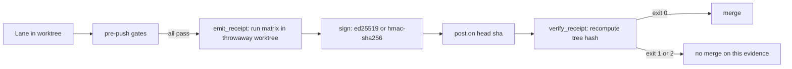

# The receipts loop

One job: explain why a lane in aesop only counts when it leaves a receipt that a gate can check, and
walk the path that receipt takes from a push to a verdict.

Status, stated first: the receipt gate is in a measurement period. The hosted `verify-receipt` check
is not required, and branch protection does not depend on it (`docs/RECEIPT-GATE.md:3-4`). The
required check list names the four `ci` shards, `windows`, `pr-footprint-gate` and
`pr-symbol-survival`, and no receipt check (`tools/required-checks.json:5-13`). Everything below
describes shipped code, and none of it says receipts replace the hosted CI run.

## The rule

An iteration counts only when it leaves receipts that a gate can check. A lane that reports success
without a receipt a gate can verify has not passed (`README.md:28`).

The reason is a measurement, not a taste. On the first day the receipt tooling existed as a manual
step, 41 merged PRs produced zero receipts, because lanes were never told to run the emitter and
nothing ran it for them (`docs/RECEIPT-GATE.md:24-26`). That is a snapshot from the day it was taken,
as recorded in the status document, not a current rate and not re-measured here.
<!-- source: the "41 merged PRs and ZERO receipts" figure is quoted from docs/RECEIPT-GATE.md lines 24-26 and hooks/pre-push-policy.sh lines 2367-2368, not recounted -->
 The fix was to stop asking lanes to remember: the pre-push hook now emits the
receipt itself (`hooks/pre-push-policy.sh:2363`, called at `hooks/pre-push-policy.sh:4058`).

## The loop

Step by step, with the code that does each one:

1. **Push.** A lane pushes from its worktree. The pre-push policy runs its gate functions in order;
   the receipt step runs once every gate above it has passed, so the receipt is bound to a tree the
   hook itself just verified (`hooks/pre-push-policy.sh:2367-2372`).
2. **Run the matrix.** `tools/emit_receipt.py` runs the verification parts in a detached throwaway
   worktree at HEAD, not in the lane's own tree (`tools/emit_receipt.py:446-465`). A tripwire compares
   HEAD, the index tree and the working-tree status before and after, and the emitter errors out if
   the matrix touched the caller tree (`tools/emit_receipt.py:364-396`).
3. **Build and sign.** The emitter records head, base, tree hash, per-part exit codes and skipped
   parts, then signs the canonical bytes with Ed25519 or HMAC-SHA256
   (`tools/emit_receipt.py:565-587`, `tools/receipt_common.py:84-107`). See
   [Signed receipts](./signed-receipts.md).
4. **Post.** `--post` publishes a `verify-receipt-local` check-run on the head sha. When the token
   cannot create check-runs (HTTP 403), the same JSON goes in a commit comment under a marker. When
   the sha is not on GitHub yet (HTTP 422), the receipt is spooled and flushed later
   (`tools/emit_receipt.py:630-678`, `docs/RECEIPT-GATE.md:53-72`).
5. **Verify.** A hosted workflow looks for the receipt on the PR head sha, then runs
   `tools/verify_receipt.py` with the verifier and keyring taken from the base tree, never the PR head
   (`.github/workflows/verify-receipt.yml:30-33`, `.github/workflows/verify-receipt.yml:142-145`). The
   verifier recomputes the tree hash from its own checkout and does not trust the number in the
   receipt (`tools/verify_receipt.py:5-6`, `tools/verify_receipt.py:223-225`).
6. **Verdict.** Exit 0 is valid, 1 is invalid, 2 means the verifier could not evaluate
   (`tools/verify_receipt.py:196`). A missing receipt is exit 1, not a pass
   (`tools/verify_receipt.py:437-441`). Field-level detail is in
   [Receipt format](../reference/receipt-format.md).

## What happens when a part is red

The emitter exits 3 when any part is red and `--fail-on-red` is set; the pre-push hook blocks on
that, and the failure receipt is still posted as the trace (`tools/emit_receipt.py:604-616`,
`docs/RECEIPT-GATE.md:26-29`). A missing python, `gh`, signing key or base emitter also blocks the
push (`docs/RECEIPT-GATE.md:29-30`). One recorded override exists: `AESOP_PUSH_RED=1` makes the
emitter exit 4 and stamps `pushed_red: true` into the receipt before signing, so the override is part
of the signed record (`tools/emit_receipt.py:785-788`, `docs/RECEIPT-GATE.md:30-31`).

`AESOP_RECEIPT_EMIT=0` does not turn emission off. It is logged as `receipt_emit_optout_ignored` and
emission still runs (`docs/RECEIPT-GATE.md:32-33`).

## What a valid receipt proves

The verifier checks, each independently (`docs/RECEIPT-GATE.md:179-190`):

1. The signature verifies under a registered key.
2. `tree_hash` equals `git rev-parse <head>^{tree}` recomputed in the verifier's checkout.
3. `head_sha` equals the checkout head.
4. `base_sha` is an ancestor of the trunk and at most 50 commits behind its tip (the `--max-behind`
   default).
5. Every required part is present with `exit_code == 0`.

## What it does not prove

- That the parts were run honestly. A key holder can sign anything; the signature authenticates the
  claimant, not the claim (`tools/verify_receipt.py:5-9`, `docs/RECEIPT-GATE.md:192-196`). The
  mechanism meant to close that gap, a random hosted re-run plus a post-merge cross-check, is listed
  under "Increments to come" and is not shipped (`docs/RECEIPT-GATE.md:226-238`).
- That a lane process cannot forge a receipt. The key-isolation design brief states that a lane
  running as the same OS user can reach the signing key today, and that this does not change any merge
  gate only because the hosted check is non-required (`docs/design/receipt-key-isolation.md:15-21`).
- Anything about parts recorded under `skipped`, such as the hosted browser and Windows parts
  (`docs/RECEIPT-GATE.md:197-198`).
- That the merge result is green. The receipt covers the head tree, not the merge with main
  (`docs/RECEIPT-GATE.md:199-200`).

## Where to go next

- How the envelope is built and signed: [Signed receipts](./signed-receipts.md)
- Check a receipt yourself, offline: [Verify a receipt](../guides/verify-receipt.md)
- Every field and exit code: [Receipt format](../reference/receipt-format.md)
- The full status document: [docs/RECEIPT-GATE.md](../RECEIPT-GATE.md)
