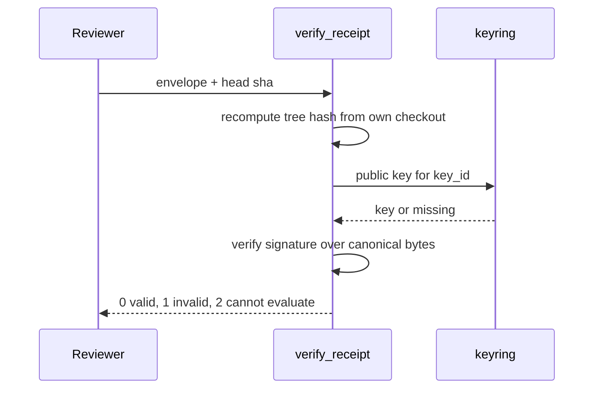

# Signed receipts

One job: explain what a receipt is made of, how it is signed, and why the verifier can trust the tree
it checks without trusting the lane that sent it.

## The envelope

A receipt travels as an envelope with two keys, `receipt` and `sig`. The verifier refuses anything
else with "cannot evaluate" (`tools/verify_receipt.py:132-136`). The `receipt` object is the claim
(which commit, which tree, which parts ran, what each exited with). The `sig` object is the signature
over that claim. Every field is listed in [Receipt format](../reference/receipt-format.md).

The receipt is not a committed file. A committed receipt would have to describe the tree that contains
it, and it would conflict on every merge, so it is posted on the head sha instead
(`docs/RECEIPT-GATE.md:95-102`, `tools/emit_receipt.py:3`).

## Canonical bytes

The signature covers canonical bytes: keys sorted, no whitespace, ASCII-escaped
(`tools/receipt_common.py:40-42`). This is a plain `json.dumps` with `sort_keys=True` and compact
separators. It is not RFC 8785 canonicalization and the code does not claim to be. Because the
signature covers every byte of that form, changing any field (an exit code, the tree, the base)
invalidates it (`docs/RECEIPT-GATE.md:117-119`).

## Two signing schemes

| Scheme | Key material | Who can forge | Cite |
|---|---|---|---|
| `ed25519` | private PEM at `$AESOP_RECEIPT_KEY` (or the default key path); public key committed | only the private key holder; the verifier holds no secret | `tools/receipt_common.py:84-98`, `tools/receipt_common.py:127-139` |
| `hmac-sha256` | shared secret in `$AESOP_RECEIPT_HMAC_SECRET` | anyone who can verify can also sign | `tools/receipt_common.py:99-105`, `tools/receipt_common.py:122-126` |

The scheme names are the constant `SCHEMES = ("ed25519", "hmac-sha256")`
(`tools/receipt_common.py:31`). A receipt names its own scheme in `sig.scheme`, and an unknown scheme
is reported as a signature failure (`tools/verify_receipt.py:212-213`).

Why two. Ed25519 is the target because it is asymmetric: a leaked CI configuration cannot forge a
receipt. HMAC exists because `tools/` is stdlib-only and a box without the `cryptography` package
still needs a way to sign; the verifying Action installs `cryptography` and accepts both
(`tools/receipt_common.py:10-13`). The status document calls HMAC strictly weaker for the same reason:
it is symmetric (`docs/RECEIPT-GATE.md:148-153`).

Signature checking returns false, and never raises, on an unknown scheme, missing key material,
malformed base64 or a library error (`tools/receipt_common.py:109-114`). The key never lives in the
repository (`tools/emit_receipt.py:3`).

## Key ids and the keyring

`sig.key_id` is the first 16 hex characters of the SHA-256 of the public key PEM, with CRLF
normalized to LF so the id is the same on every checkout (`tools/receipt_common.py:78-81`). For HMAC
it is the first 16 hex characters of the SHA-256 of the secret (`tools/receipt_common.py:105`).

For Ed25519 the verifier looks at the registered keys: the committed `tools/receipt_pubkey.pub` plus
every `tools/receipt_pubkeys/*.pub` (`tools/receipt_common.py:146-158`). It picks the key whose id
equals `sig.key_id`, and the signature must still verify under that key; the id is a lookup hint only
(`tools/receipt_common.py:161-176`). A key that is not registered therefore produces an INVALID
verdict. The [how-to](../guides/verify-receipt.md) shows this with a freshly generated key.

The public key is a `.pub` file, not `.pem`, because the repository's secret scanner treats every
`*.pem` filename as a credential finding (`tools/receipt_common.py:5-8`).

## Base trust

The hosted workflow reads the verifier and the keyring from the base tree (the PR's base sha, or
`main` on a manual run), never from the PR head. A PR that registers its own signer key cannot make
its own receipt verify; the key takes effect only after that PR merges
(`.github/workflows/verify-receipt.yml:30-34`, `docs/RECEIPT-GATE.md:163-175`). In code, the verifier
accepts a keyring directory override so the workflow can point it at the base copy
(`tools/receipt_common.py:149-155`, `tools/verify_receipt.py:375-377`).

## Tree binding

The tree hash is the binding. The verifier recomputes `git rev-parse <head>^{tree}` in its own
checkout and compares it with `receipt.tree_hash`; it never trusts the number the lane supplied
(`tools/verify_receipt.py:220-225`, `tools/emit_receipt.py:5-8`). It likewise compares `head_sha` with
the checkout head, requires `base_sha` to be an ancestor of the trunk, and rejects a base more than
`--max-behind` (default 50) commits behind (`tools/verify_receipt.py:221-236`,
`tools/verify_receipt.py:372`).



## Where the matrix runs

The emitter runs the parts in a detached throwaway worktree at HEAD. A tripwire records HEAD, the
index tree and the working-tree status first and compares them afterwards; any difference is an
error (`tools/emit_receipt.py:364-396`, `tools/emit_receipt.py:446-475`).

Parts also run with a scrubbed environment. The scrub list includes the receipt signing material
itself, because a part runs the pushed head's test code and an inherited secret would let that code
forge an accepted receipt (`tools/emit_receipt.py:230-243`). The names that were scrubbed are recorded
in the receipt under `env.scrubbed` (`tools/emit_receipt.py:585`).

## Limits, stated plainly

- A valid signature proves the key holder signed this exact receipt. It does not prove the parts ran
  honestly (`tools/verify_receipt.py:5-9`).
- The hosted receipt check is not required, so no merge is gated on it today
  (`docs/RECEIPT-GATE.md:3-4`). This page does not claim receipts replace the hosted CI run.
- A lane running as the box owner can reach the signing key today, per the key-isolation design brief
  (`docs/design/receipt-key-isolation.md:15-21`). That brief is a proposal; no isolation change is
  described here as shipped.
- The honesty mechanism (random hosted re-runs and a post-merge cross-check) is a listed future
  increment (`docs/RECEIPT-GATE.md:226-238`).

## Evidence

The verifier has a test module. Its result on the tree this page was measured against:

```
$ python -m unittest tests.test_verify_receipt
Ran 48 tests in 25.647s

OK
```

<!-- count: 48 from `python -m unittest tests.test_verify_receipt` on origin/main 8ede5e06 -->

The same run prints a few diagnostic lines from fixture lookups after the summary; those are test
output, not failures. Cases include a wrong tree, a wrong head, an expired base, a tampered part exit
code, a wrong secret, no key material, an unknown scheme and a malformed envelope
(`tests/test_verify_receipt.py:105-170`).

Next: [verify a receipt yourself](../guides/verify-receipt.md), or read the
[field reference](../reference/receipt-format.md).
