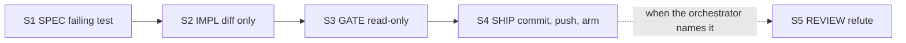

# Stage lanes

A change does not reach CI in one agent run. It moves through a pipeline of
**stage lanes**: one short contract per stage, each handing a named artifact to the
next. This page describes the stages, what each one may read, write, and run, and
where the rules stop being enforced by code.

Every claim cites the file and line it comes from, in the form `path:line`. Paths are
relative to the repository root.

## The rule

A change reaches CI through a pipeline of stage lanes, never one lane. S1 SPEC writes
the failing test. S2 IMPL makes exactly that test green. S3 GATE runs the gates
read-only. S4 SHIP commits, pushes, and arms the pull request. S5 REVIEW refutes the
diff.
(source: `docs/STAGE-CONTRACTS.md:7`)

Each stage is a separate dispatch. A brief names exactly one stage, and the brief is the
filled template for that stage and one change category, nothing more
(source: `docs/STAGE-CONTRACTS.md:7`, `docs/STAGE-CONTRACTS.md:172`).

The graph shows the normal order. S5 is optional: the orchestrator names it, and the
contract does not make it mandatory for every category
(source: `docs/STAGE-CONTRACTS.md:168`).

## The stages

Each stage declares what it takes in (IN), what it must produce (OUT), what it may
do (ALLOWED), what it must not do (FORBIDDEN), and what it returns to the orchestrator
(HAND BACK). The table below is the generic form of those fields. The full
per-category matrix is in [the stage matrix reference](../reference/stage-matrix.md).

| Stage | IN | OUT | Key rule | Source |
|---|---|---|---|---|
| S1 SPEC | a row or a ruling | a failing test path and its red output | may write the test file; must not edit non-test files, commit, or push | `docs/STAGE-CONTRACTS.md:12` |
| S2 IMPL | the S1 test path and its red output | a diff file | makes that one test green; must not edit the test, commit, or push; must not run gates other than the named test | `docs/STAGE-CONTRACTS.md:13` |
| S3 GATE | the S2 diff | a gate log file | read-only; no Edit, Write, commit, push, or baseline update | `docs/STAGE-CONTRACTS.md:14` |
| S4 SHIP | the S3 PASS and a message file | PR number, head sha, armed state | commit, foreground push, open PR, arm auto-merge; no code edits, no `--no-verify`, no manual merge | `docs/STAGE-CONTRACTS.md:15` |
| S5 REVIEW | the S4 PR diff and the ruling | a review file | read-only; no edit, commit, or push | `docs/STAGE-CONTRACTS.md:16` |

Two stages exist only for one project-specific bugfix category, which is not part of
the generic pipeline described here: an evidence capture (S0) and a validation pass
after S3 (S5 VALIDATE)
(source: `docs/STAGE-CONTRACTS.md:11`, `docs/STAGE-CONTRACTS.md:17`).

### Hand-back gates the next stage

A stage does not start until the previous stage's hand-back names its output artifact,
either a path or a sha
(source: `docs/STAGE-CONTRACTS.md:170`). The S3 hand-back is a PASS line or the id of
the catalog recipe that matched
(source: `docs/STAGE-CONTRACTS.md:14`).

## Categories change the stage cells

The same stage verb means different things per category. The contract names these
generic categories:

- **code change**: a test-first change to a tool or hook, with its own test file
  (the contract's `hook` and `script` categories,
  `docs/STAGE-CONTRACTS.md:21-22`).
- **docs change**: markdown or prose only. No code and no gates beyond the secret
  scan (`docs/STAGE-CONTRACTS.md:23`).
- **CI fix**: one red CI run matched to one row of a recurring-failure catalog
  (`docs/STAGE-CONTRACTS.md:28`, `docs/CI-CATALOG.md`).

Two consequences follow from the contract text:

- A docs change skips S1. Its S1 cell reads "SKIPPED"
  (`docs/STAGE-CONTRACTS.md:54`, `docs/STAGE-CONTRACTS.md:171`).
- A docs change runs the secret scan only at S3. The fast check that code changes
  run is skipped for docs-only work (`docs/STAGE-CONTRACTS.md:98-99`,
  `docs/STAGE-CONTRACTS.md:171`).

## Lanes are stateless and killed on failure

The contract states the failure model directly. Lanes are stateless processes. A lane
that fails is killed, not corrected. The question after a failure is what the contract
did not specify. The fix is an amendment to the contract, followed by a fresh lane
(source: `LANE-CONTRACT.md:5-9`).

The stated aim of the stage split is "smaller contracts, aimed at the vertical delivery
pipeline, for categories" (source: `docs/STAGE-CONTRACTS.md:7`). For what restart means
for the rest of the system, see [crash-only operation](crash-only.md).

## What is enforced and what is not

The stage contract is text. The contract gives the orchestrator's order as S1, S2, S3,
S4, with S5 when named (source: `docs/STAGE-CONTRACTS.md:168`). No checker in this
repository is described as enforcing that order.

- `tools/dispatch_lint.py` is the dispatch linter in this repository. Its own
  description says it enforces merge automation and security rules for agent prompts,
  such as flagging `gh pr merge` without `--auto`
  (source: `tools/dispatch_lint.py:1-2`, `python tools/dispatch_lint.py --help` output:
  "enforces merge automation and security rules").
- A text search of `tools/dispatch_lint.py` finds no reference to stages. This page
  does not claim that the linter checks stage order.

> The contract says a brief that names more than one stage is denied by the dispatch
> hook (`docs/STAGE-CONTRACTS.md:172`). This repository does not contain that hook,
> so the rule is documented here as contract text only.

## Related pages

- [Crash-only operation](crash-only.md): how lanes and daemons recover from failure.
- [Stage matrix](../reference/stage-matrix.md): the full stage-by-category table.
