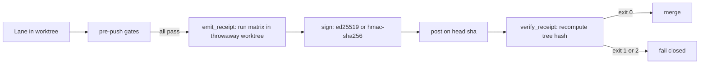
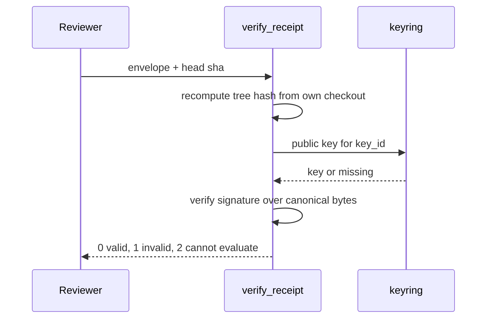
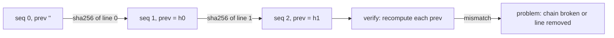
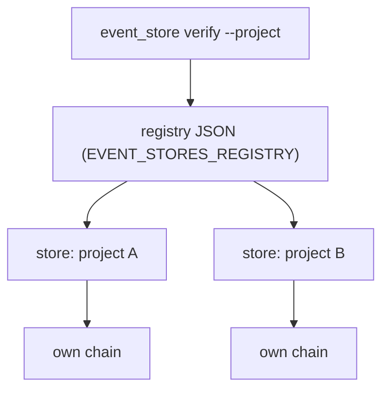
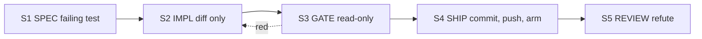
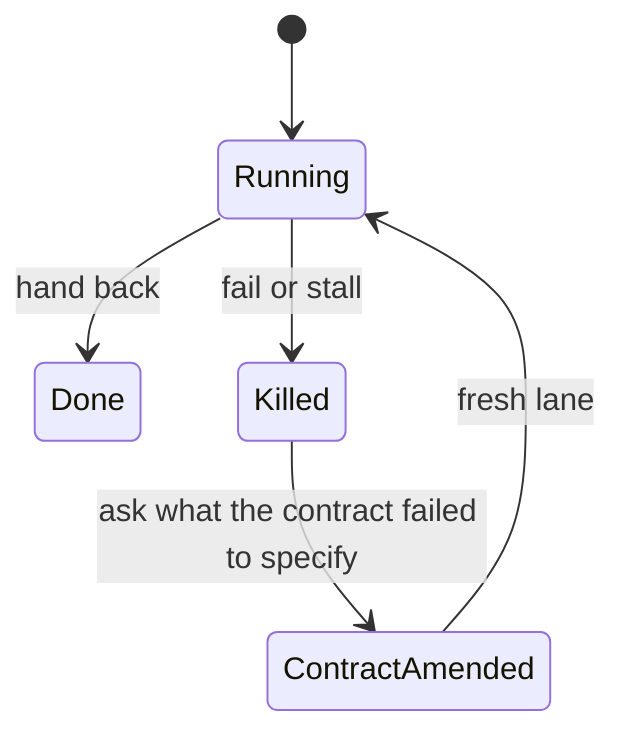
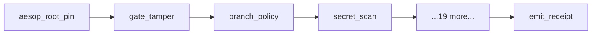

# OSS blueprint docs: rewrite plan (S1 SPEC)

Status: real plan, S1 only. No doc is rewritten by this file. Row f-260fea4a. Ascii only.
PURPOSE: rewrite aesop's docs so a stranger can adopt the repo as a blueprint, with every claim
backed by disk evidence on origin/main (head 062a5d2e at planning time, 2026-10-26).
Read with LANE-CONTRACT.md and docs/STAGE-CONTRACTS.md (docs category skips S1; this plan is the S1 stand-in).

Evidence key: `path:line` = a line on origin/main 062a5d2e. `CMD` = a command run from the repo root with its
expected output. Lines drift on edit; S3 re-measures every cite (section 6).

---

## 0. Findings in one screen

| Item | Count |
|---|---|
| Target pages | 33 |
| Unsupported claims (drop or build, never write) | 11 (section 3.3) |
| P0 wrong statements in current docs | 12 (section 5) |
| Blockers to flag, not fix | 8 (section 7) |
| S2 writer lanes | 8 (section 6) |
| Diagrams (Mermaid) | 8, images 0 |

The repo is PUBLIC now (`gh repo view matt82198/aesop --json visibility` -> `{"visibility":"PUBLIC"}`), the
package is 0.11.0 (`package.json` "version"; `npm view @matt82198/aesop version` -> `0.11.0`), and the license
is PolyForm Noncommercial 1.0.0 (`LICENSE:1`, `package.json` "license"). The last is not an open-source
license by the OSI definition; section 7 flags it for Matt and the plan does not pick for him.

Two facts shape the whole IA:

1. The strongest differentiator (claim binding, the lane hooks, the fail-closed brain hooks) lives in the
   private `claude-config` repo. The public tree only names it (`docs/PROVENANCE.md:24`,
   `docs/MACHINERY-MAP.md:297`). Pages may describe the concept as "brain-side, not shipped" and may not
   claim shipped behavior.
2. The shipped, testable core is: Ed25519/HMAC signed receipts, the tree-bound verifier, the hash-chained
   event store, per-project stores, the 23 pre-push checks, the stage-lane contract text. Pages are built on
   that core.

---

## 1. Inventory

Verdicts: KEEP (reader-facing as is, plus S3 fixes), REWRITE (content stays in the IA but is rewritten),
MERGE (folded into a named target page, file retired), RETIRE (move out of reader path; archive or delete
per section 7 decisions). Target ids (e.g. `C2`) are the pages in section 2.

### 1.1 Root files

| File | Verdict | Why |
|---|---|---|
| README.md | REWRITE -> `README` | 227 lines mix pitch, credibility, install and 3 wrong figures (W1, W2, W8, W9). Open with the receipts loop, link to the IA. Keep the kernel/you-fill-in table (every path verified to exist). |
| CONTRIBUTING.md | REWRITE -> `X2` | Duplicates docs/CONTRIBUTING.md; both promise "welcome" under a noncommercial license. One file, root. |
| SECURITY.md | REWRITE -> `X3` | Names 0.10.x as the only supported line (W4); has no CVE notice (blocker B1). |
| LICENSE | KEEP | Verbatim PolyForm text. Decision is Matt's (B3). |
| CHANGELOG.md | KEEP | 1169 lines, Keep a Changelog format. S3 fixes only: line 55 says the repo "goes private" (historical, now PUBLIC; add a dated note, do not rewrite history). |
| RELEASE-NOTES.md | REWRITE -> `X4` | Says UNRELEASED/0.9.2 while 0.11.0 ships (W5). Generate from CHANGELOG top section or retire. |
| CITATION.cff | KEEP | Valid metadata; license field must follow B3. |
| CLAUDE.md | KEEP (not reader-facing) | Dev navigation for lanes. Contributor page `X2` links it. |
| CLAUDE-TEMPLATE.md | KEEP | Shipped brain template, linked from quickstart. |
| LANE-CONTRACT.md | KEEP + pointer from `C5` | Public lane contract; 11 lines contain C:/Users/Mattt paths (B4). |
| LANE-CONTRACT-MIN.md | RETIRE from reader path | Arm B of a private A/B; links to `state/lane-ab.jsonl` not in repo. |
| INDEX.md (root) | MERGE -> `D0` | Generated by `knowledge_tree.py`, which is not in this repo (`ls tools | grep knowledge` -> empty). |
| STATE.md, BUILDLOG.md | RETIRE from reader path | Operator logs (21 and 22 lines with C:/Users/Mattt, B4). Keep in repo, not linked from docs home. |
| NOTES.md | MERGE -> `R4` | Audit-log trust model; fold the one reader-relevant section into the gate reference. |
| SEATED_REDO_SUMMARY.md | RETIRE | Dated 2026-07-24 increment report, "API results pending". |
| AUDIT-BACKLOG.md | RETIRE | Self-declared OBSOLETE (its line 2). |

### 1.2 docs/*.md (61 files)

| File | Verdict | Why |
|---|---|---|
| README.md | REWRITE -> `D0` | Stale config keys (W6); becomes the docs home, absorbs INDEX.md. |
| INDEX.md | MERGE -> `D0` | Says "57 entries", omits CI-CATALOG, PROVENANCE, STAGE-CONTRACTS (W7); generator absent. |
| INSTALL.md (616) | REWRITE -> `H1` | Right topic, too long; split off config, pitfalls. |
| CONFIGURE.md | REWRITE -> `H2` + `R2` | Conflict with example config on `aesop_root` (W10). |
| FIRST-WAVE.md (549) | REWRITE -> `H3` | Keep the replay kit walk; cut to what `examples/first-wave-baseline/` actually contains. |
| DEMO.md | MERGE -> `Q1` | Zero-key demo is the quickstart. |
| ANY-REPO.md (427), PORTING.md | MERGE -> `H7` | Two overlapping adopter walkthroughs. |
| ADOPTION-CHECKLIST.md | KEEP -> `H8` | Each step names a command; S3 runs them. |
| HOOK-INSTALL.md | REWRITE -> `H4` + `R4` | Count is wrong (W3). |
| CI-MODES.md | KEEP -> `H9` | Maps to `--ci-mode` flags (`bin/cli.js:522`). |
| ACTIONS-TEMPLATE.md | MERGE -> `H9` | Template for the hosted mode. |
| CI-CATALOG.md | KEEP -> `R6` | 48 lines, recipes; has internal repo names (B4). |
| RECEIPT-GATE.md | REWRITE -> `C2`, `H5`, `R3` | Accurate status text ("not required"); split by reader task. |
| RECEIPTS.md | RETIRE | Different thing (per-wave metrics, July snapshot) sharing the word "receipt". Name collision hurts newcomers; move to `P5` appendix. |
| ARCHITECTURE.md | REWRITE -> `C1` | One wave diagram; rebuild around the receipts loop. |
| CONCEPTS.md | REWRITE -> split into `C1..C9` | Generic TL;DR; replaced by one page per concept. |
| HOW-THE-LOOP-WORKS.md | MERGE -> `C1`, `H3` | Wave walkthrough. |
| MICROKERNEL.md (482) | KEEP -> `C10` | Two-seat design; verify claims in S3. |
| CHECKPOINTING.md | KEEP -> `C9` | STATE/BUILDLOG discipline. |
| WHY-CRASH-ONLY.md, crash-only-whitepaper.md | MERGE -> `C6` | Two long essays on one idea; keep the whitepaper's evidence tables, drop the rest. |
| THE-AESOP-HYPOTHESIS.md | MERGE -> `C6` | Philosophy; 1 path leak (B4). |
| DECISIONS.md | KEEP -> `P2` | ADRs. |
| CARDINAL-RULES.md | REWRITE -> `C7` | Says subagents are always Haiku; the policy hook honors config `cardinal_rules.subagent_model` (`hooks/claude/force-model-policy.mjs:9`). State as policy default. |
| DISPATCH-MODEL.md | KEEP -> `P2` | Cost model; numbers trace to private data (U5). |
| GOVERNANCE.md, RELIABILITY.md, SCRIPTS-POLICY.md | MERGE -> `C7`/`C9` | Overlap with cardinal rules; SCRIPTS-POLICY describes a private ~/scripts library (retire from reader path). |
| BEHAVIORAL-PR-REVIEW.md | KEEP -> `H10` | Reviewer checklist. |
| STAGE-CONTRACTS.md | REWRITE -> `C5` + `R5` | 43 internal-name and path hits (keyrun, ~/scripts, claude-config). Public version keeps S1-S5 and the generic categories only. |
| FORENSICS.md | KEEP -> `H11` | Bisecting agent failures. |
| GATES-FIRED.md, INCIDENTS.md, REFUTED.md | KEEP -> `P3`, `P4`, `P5` | Evidence ledgers. INCIDENTS.md is generated; counts must come from it (W1). |
| INCIDENT-RESPONSE-SLA.md, LATENCY.md, RELIABILITY-REPORT.md/.json, CROSSOS-DRIFT.md/.json, HANDOFF-CERTIFICATE.md, convergence-log-wave1.md | RETIRE | Dated generated snapshots (SLA ends 2026-07-13); the JSON carries 1 path leak. Move to `docs/archive/`. |
| MACHINERY-MAP.md (531) | KEEP -> `R7` | Basis cb972c56 is 201 commits old (W12); regenerate basis. |
| MEMORY-TEMPLATE.md | KEEP | Shipped template; 3 placeholder links are intentional. |
| MULTI-INSTANCE-ROADMAP.md, TEAM-STATE.md | MERGE -> `C4` | TEAM-STATE says "Status (0.7.2)" (W11); keep the shared-directory claim path only. |
| REMOTE-ACCESS.md, REMOTE-OBSERVABILITY.md, OBSERVABILITY-RUNBOOK.md, av-resilience.md | KEEP, demote | Operator extras under `Reference > Operations`; S3 checks each cited command. |
| RESTORE.md | KEEP -> `H12` | Reconstitution; contains private-path assumptions (B4). |
| PUBLISHING.md, RELEASING.md | MERGE -> `X4` | Maintainer-only; RELEASING.md:76 link is broken (W13). |
| TESTING.md | KEEP -> `X2` | Contributor section. |
| PROVENANCE.md, PROVENANCE.receipt.json | KEEP -> `P1` | 19 rows reference private repos; this is the file that says what is not open (B2). |
| CODE-TASTE.md, autonomous-swe.md, how-i-built-aesop.md, case-study-portfolio.md, ab-cost-dataset.md, reproduce.md | see below | |

Last row detail: CODE-TASTE KEEP (`P2`); autonomous-swe, how-i-built-aesop, case-study-portfolio
RETIRE to `docs/archive/narrative/` (first-person narrative, portfolio framing, path leaks);
ab-cost-dataset REWRITE (its raw data is "private conductor3 archive", `docs/ab-cost-dataset.md:6`, U5);
reproduce.md KEEP -> `H13` (a command-driven path, 1 path leak).

### 1.3 docs subdirectories

| Path | Verdict | Why |
|---|---|---|
| docs/plans/ | KEEP, not in nav | PER-PROJECT-EVENT-STORES.md is a plan with 14 path leaks (B4); `C4` is the reader page. THROUGHPUT-PLAN: retire. |
| docs/design/ | KEEP -> `C4`, `C2` | receipt-key-isolation.md and MULTIBOX-DESIGN.md back claims. |
| docs/img/ | KEEP | kernel-boundary.mmd + .svg; the .mmd is the source of D1. |
| docs/blog/ (3), docs/interview-stories/ (3), docs/drafts/ | RETIRE | Marketing/portfolio prose; 3 blog files have path leaks. |
| docs/paper/, docs/recordings/, docs/templates/ | KEEP, link from `P5` | Evidence artifacts. paper/evidence.json has 2 path leaks (B4). |
| docs/archive/ | KEEP | Receives retired files. |

---

## 2. Target information architecture

Reader path: what -> try -> understand -> do -> look up -> trust. One concept per page, smallest split.
Ids are stable handles for the lane plan. Proposed tree:

```
README.md                      README   what it is, one diagram, 3 commands
docs/README.md                 D0       docs home, the map below
docs/quickstart.md             Q1
docs/concepts/                 C1..C10
docs/guides/                   H1..H13
docs/reference/                R1..R7
docs/provenance/               P1..P5
CONTRIBUTING.md SECURITY.md CHANGELOG.md RELEASE-NOTES.md   X2 X3 X4
```

| Id | Page | One job |
|---|---|---|
| README | Root README | One screen: the receipts loop, honest status, three commands |
| D0 | Docs home | The map; replaces INDEX.md and docs/README.md |
| Q1 | Quickstart | Zero-key demo, then verify a receipt locally |
| C1 | The receipts loop | A lane counts only if it leaves a receipt a gate can check |
| C2 | Signed receipts | Envelope, schemes, tree binding |
| C3 | Hash-chained event store | Append-only log, `prev` = sha256 of previous line |
| C4 | Per-project stores | One chain per project, registry, migration |
| C5 | Stage lanes S1-S5 | Crash-only pipeline, one contract per stage |
| C6 | Crash-only | Killed, never corrected; restart is recovery |
| C7 | Gates and hooks | Pre-push chain, repo hooks vs brain hooks |
| C8 | Claim binding | Brain-side concept; gated on U1 (build or drop) |
| C9 | Durable state | STATE.md, BUILDLOG.md, state_store |
| C10 | Two seats (microkernel) | Worker and orchestrator backends |
| H1 | Install and scaffold | npx scaffold, doctor |
| H2 | Configure | aesop.config.json |
| H3 | Run your first wave | /power then /buildsystem on the replay kit |
| H4 | Install the pre-push hook | |
| H5 | Verify a receipt | offline, no network |
| H6 | Verify an event store | |
| H7 | Adopt in an existing repo | merges ANY-REPO + PORTING |
| H8 | Adoption checklist | |
| H9 | Pick a CI mode | hosted / self-hosted / local-receipt-gate |
| H10 | Review a behavioral PR | |
| H11 | Debug an agent failure (forensics) | |
| H12 | Restore after a wipe | |
| H13 | Reproduce the repo's claims | |
| R1 | CLI reference | subcommands and flags |
| R2 | Config reference | every key |
| R3 | Receipt format | fields, exit codes |
| R4 | Gate reference | the 23 pre-push checks, in order |
| R5 | Stage contract matrix | S0-S5 x category, generic |
| R6 | CI failure catalog | |
| R7 | Machinery map | |
| P1 | Provenance | what is public, what is private |
| P2 | Design decisions | ADRs, dispatch cost model |
| P3 | Incidents | |
| P4 | Gates fired | |
| P5 | Refuted ledger and evidence | |
| X2 | Contributing | |
| X3 | Security policy | |
| X4 | Release notes and releasing | |

That is 41 ids. Pages that exist as new files and are claim-bearing in this plan: 33 (section 3 lists them;
D0, H8, H10-H13, R6, R7, X4 reuse existing, mostly-kept content and carry S3 fixes only). The count handed
back is **33 pages rewritten or created**, 8 kept with fixes.

---

## 3. Claims and evidence, per page

Rule: a claim appears on a page only with the evidence listed here. S3 re-runs every CMD and re-reads every cite.
Test commands run from the repo root; baseline taken 2026-10-26 on this worktree:
`python -m unittest tests.test_event_store_core tests.test_verify_receipt` -> `Ran 63 tests` / `OK`.

### 3.1 Entry pages

**README**
- Aesop ships dispatch, gates, receipts, merge, watchdog, durable state, dashboard. Evidence: every path in the
  README table exists (CMD: `ls driver/wave_loop.py hooks/pre-push-policy.sh tools/emit_receipt.py state_store/store.py ui/serve.py mcp/server.mjs` -> all listed, no error). Verified 2026-10-26: 30 of 30 README table paths exist.
- Gate and receipt files: `hooks/pre-push-policy.sh:796` (`check_secret_scan`), `:2363` (`check_emit_receipt`), `tools/emit_receipt.py:1-8`.
- The status of the receipt gate is "measurement mode, hosted check not required": `docs/RECEIPT-GATE.md:3-4`.
- Version and license: `package.json` `"version": "0.11.0"`, `"license": "PolyForm-Noncommercial-1.0.0"`; `LICENSE:1`.
- The CLI has `doctor|watch|dash|status|fleet|health|health-score|reproduce|init|runner`: `bin/cli.js:246`; `--demo`: `bin/cli.js:130`.
- Zero npm runtime deps: `package.json` has no `dependencies` key (CMD: `node -e "console.log(Object.keys(require('./package.json')))"` -> no `dependencies`).

**D0** - claims: the map only. Evidence: S3 link check (CMD in section 6) -> `0` broken links.

**Q1 Quickstart** - claims: `npx @matt82198/aesop dash --demo` runs with no keys (`bin/cli.js:130`, `ui/serve.py:32-35`); a receipt can be verified offline (`tools/verify_receipt.py:3-6`).
CMD for S3: `node bin/cli.js --help` -> prints `aesop - Multi-agent orchestration template scaffolder` and the Usage block (observed).

### 3.2 Concepts

**C1 The receipts loop**
- An iteration counts only with a gate-checkable receipt: `STATE.md:3` (PURPOSE line) and `README.md` "What It Is".
- Emission is automatic on push after earlier gates pass: `docs/RECEIPT-GATE.md` (the "Emission is now automatic" paragraph); code `hooks/pre-push-policy.sh:2363` and call `:4058`.
- Verification is by a hosted action that recomputes the tree hash: `.github/workflows/verify-receipt.yml`; `tools/emit_receipt.py:6-8`.
- Diagram D1.

**C2 Signed receipts**
- Canonical bytes: sorted keys, no whitespace, ASCII: `tools/receipt_common.py:40-42`. (Do not call this JCS; it is not RFC 8785.)
- Schemes are `ed25519` and `hmac-sha256`: `tools/receipt_common.py:31`; signing `:84-107`; HMAC exists because tools/ is stdlib-only: `:10`.
- Verifier exit codes 0 valid, 1 invalid, 2 cannot evaluate: `tools/verify_receipt.py:196`.
- The verifier recomputes the tree hash from its own checkout and never trusts the receipt's number: `tools/emit_receipt.py:8`, `tools/verify_receipt.py:5-6`.
- The matrix runs in a throwaway worktree and a tripwire fails if it mutated the caller tree: `tools/emit_receipt.py:392-396`, `:446-475`.
- Public keyring: `tools/receipt_pubkeys/` (one `.pub`); CMD: `ls tools/receipt_pubkeys` -> `mattt-box-00946e62ea15ecd4.pub` (box-named file: B4).
- Evidence tests: CMD `python -m unittest tests.test_verify_receipt` -> `OK`.
- Limit stated: receipt gate is non-required, so the claim "receipts replace redundant CI" is NOT made (U4).

**C3 Hash-chained event store**
- Each line carries `prev` = sha256 of the previous line's bytes (no trailing newline), seq store-wide, first `prev` is `""`: `tools/event_store/store.py:3-6`, `:24-25`, `:106`.
- Exact key set `v ts seq kind actor session text refs prev`: `tools/event_store/store.py:17`.
- Verify reports `prev mismatch (chain broken or earlier line removed)`: `tools/event_store/store.py:131-132`.
- CLI is `append|verify|project`: `tools/event_store/cli.py:64,100,122`; CMD `python -I tools/event_store/cli.py --help` -> `usage: event_store [-h] {append,verify,project} ...` (observed).
- Append-only pre-commit guard rejects deletes, rewrites, renames: `tools/event_store/guard/events_append_only.sh:2-4`.
- Wording rule: say "tamper-evident under verify", never "tamper-proof" (U10).
- Tests: CMD `python -m unittest tests.test_event_store_core` -> `OK` (63-test run above covers it).
- Diagram D3.

**C4 Per-project stores**
- One chain per project, chosen by a registry at `~/.claude/event-stores.json` or env `EVENT_STORES_REGISTRY`: `tools/event_store/registry.py:1,7,16-19`.
- `init`, `migrate`, `project` exist: `tools/event_store/init.py`, `migrate.py`, `project.py`; tests `tests/test_event_store_init.py`, `test_event_store_migrate.py`, `test_event_store_project.py`.
- The motivating defect (one chain for every project, 74 of 256 events unattributable): `docs/plans/PER-PROJECT-EVENT-STORES.md:9-10`. Cite as a measured snapshot dated 2026-10-22.
- Shared-directory multi-instance coordination: `docs/MULTI-INSTANCE-ROADMAP.md` (Phase 0.5 paragraph); code `state_store/fs_claim_log.py`, `state_store/lease_claims.py`; tests `tests/test_fs_claim_log.py`, `tests/test_lease_claims.py`.
- NOT claimed: that the live cutover to per-project stores finished (U8).
- Diagram D4.

**C5 Stage lanes S1-S5**
- S1 SPEC writes the failing test, S2 IMPL makes it green, S3 GATE read-only, S4 SHIP commits and arms, S5 REVIEW refutes: `docs/STAGE-CONTRACTS.md:5`, stage cells `:9-17`.
- Each stage names IN, OUT, ALLOWED, FORBIDDEN, HAND BACK: `docs/STAGE-CONTRACTS.md:9-17`.
- Docs-only changes skip S1: matrix row "S1 SPEC | docs | SKIPPED".
- The stateless-lane rule "A lane that fails is KILLED, never corrected": `LANE-CONTRACT.md:5`.
- The public page keeps stage semantics only. Enforcement is by brain-side dispatch hooks that are not in this repo (U2): say "the contract is text plus a dispatch-lint tool", and cite `tools/dispatch_lint.py` and `tools/multi_dispatch.py` only after S3 confirms what they check (CMD: `python tools/dispatch_lint.py --help`).
- Diagram D5.

**C6 Crash-only**
- Workers are stateless; state is in git + SQLite + files: `README.md` "Background"; `state_store/store.py:5` (WAL).
- Watchdog restarts stale daemons and honors a halt switch: `daemons/run-watchdog.sh:9`, `daemons/selfheal.sh`.
- A failed lane is relaunched fresh, not repaired: `LANE-CONTRACT.md:5-8`.
- Handoff proof for crash-resume: `docs/HANDOFF-CERTIFICATE.md` and `tools/handoff_proof.py` (S3 runs `python tools/handoff_proof.py --help`).
- Diagram D6.

**C7 Gates and hooks**
- 23 `check_*` functions in the pre-push policy: CMD `grep -cE '^check_[a-z_]+\(\)' hooks/pre-push-policy.sh` -> `23`.
- Order and names: list in section 5 W3 evidence; main chain ends with `check_emit_receipt` at `hooks/pre-push-policy.sh:4058`.
- Secret scan blocks a push: `hooks/pre-push-policy.sh:796`, `tools/secret_scan.py`.
- Three Claude Code hooks ship as files, wiring is the user's job: `hooks/claude/` (CMD: `ls hooks/claude` -> `force-model-policy.mjs`, `no-heredoc-file-authoring.mjs`, `no-scrollback-as-record.mjs` plus tests).
- `force-model-policy` rewrites a non-compliant model to the policy model and logs the bypass token: `hooks/claude/force-model-policy.mjs:1-12`.
- Server-side branch protection is what makes a gate real: `docs/HOOK-INSTALL.md:3`; required contexts list `tools/required-checks.json`.
- NOT claimed: that brain hooks fail closed in every Claude Code version. The README itself says they do not all fire (U3).
- Diagram D7.

**C8 Claim binding** - BLOCKED by U1. Public evidence is only `docs/PROVENANCE.md:24` (names `hooks/claude-config`'s `claim-binding.mjs`) and `docs/MACHINERY-MAP.md:297`. Page ships only if a lane builds it: port a minimal claim-binding hook into `hooks/claude/` with a behavioral test (a "merged" claim is denied unless the same turn holds a `gh pr view` read). Until then the page is a 6-line stub that says "brain-side pattern, not shipped" and links P1.

**C9 Durable state**
- STATE.md holds intent/phase/next steps, BUILDLOG.md is append-only: `docs/CHECKPOINTING.md:1`.
- SQLite WAL store with projections: `state_store/store.py:5`, `state_store/projections.py`.
- The kernel reads STATE.md: `driver/orchestrator_driver.py` (S3 greps `STATE.md` there).
- Rotation of oversized logs: `tools/rotate_logs.py`.

**C10 Two seats** - claims limited to what `docs/MICROKERNEL.md:1-3` states shipped (HS-1 config, HS-2 swap); S3 verifies with `ls driver/orchestrator-swap` and `python -m unittest` on the swap tests it names. Any benchmark figure in that page is dropped unless it cites a file in `bench/`.

### 3.3 Unsupported, drop or build (never written)

| Id | Claim | Where it appears now | Why unsupported | Resolve |
|---|---|---|---|---|
| U1 | Claim binding gates "merged/green" statements | PROVENANCE.md:24, MACHINERY-MAP.md:297 | Hook is in private claude-config; no public code or test | Build (port + behavioral test) or drop `C8` |
| U2 | Stage contracts are enforced by hooks | STAGE-CONTRACTS.md, README | Enforcer is a private dispatch hook; public tree has text and `tools/dispatch_lint.py` only | Reword to what dispatch_lint checks, or build a public lint test |
| U3 | Hooks fail closed | README "Background", MACHINERY-MAP | README itself states hooks are "not fully firing" | Drop; state the measured status |
| U4 | Receipts replace redundant CI | RECEIPT-GATE.md title | Gate is non-required (RECEIPT-GATE.md:3-4); no measurement published | Drop title claim; keep "measurement period" |
| U5 | Hierarchical dispatch is 4.3x weighted cost at equal quality | README, DECISIONS, DISPATCH-MODEL | Raw data is a private archive (`docs/ab-cost-dataset.md:6,144-148`) | Build (publish dataset under bench/) or label "author-reported, not reproducible" |
| U6 | "Caught incident #464", "7+ gate-activation incidents" | README | INCIDENTS.md shows 3 gate-activation, 1 fake-green, no #464 | Drop; replace with counts computed from INCIDENTS.md |
| U7 | gate-escape-resolver turns CI failures into enforcement | README "Self-learning" | Skill is not in `skills/` (`ls skills` -> buildsystem dashboard fleet healthcheck power) | Drop, or ship the skill |
| U8 | Per-project stores are live and replaced the shared log | PROVENANCE, CHANGELOG framing | Code and migrator ship; no public evidence the cutover ran | State "tooling ships"; do not state cutover |
| U9 | Multi-model backends (Codex, OpenAI-compatible) work | CLAUDE.md driver row, MICROKERNEL | Not verified in this plan | S3 per-page check: run the driver tests it cites, else drop |
| U10 | Event log is "tamper-proof" | any draft | Chain is verifiable, not signed; guard is a local pre-commit hook | Use "tamper-evident" |
| U11 | "Fail-closed verification is the one invariant" as a universal | README "Background" | Contradicts U3 for brain-side hooks | Scope to the shipped pre-push chain |

Unsupported-claim count: **11**.

---

## 4. Diagrams

All Mermaid, GitHub-rendered. Images: **none**. Every diagram here is a flow, sequence or state machine that
Mermaid carries; an image would add no claim. If Matt later wants a hero image, the only candidate is the
kernel boundary (D8) and it already exists as `docs/img/kernel-boundary.svg`, so no generation is planned.

**D1 Receipts loop** (README, C1). Derived from `hooks/pre-push-policy.sh:2363,4058`, `tools/emit_receipt.py`, `tools/verify_receipt.py`, `.github/workflows/verify-receipt.yml`.


**D2 Receipt verify sequence** (C2). Derived from `tools/verify_receipt.py:196`, `tools/receipt_common.py:109`.


**D3 Event chain** (C3). Derived from `tools/event_store/store.py:3-6,17,106,131`.


**D4 Per-project stores** (C4). Derived from `tools/event_store/registry.py:1-19`, `cli.py:100-120`.


**D5 Stage pipeline** (C5). Derived from `docs/STAGE-CONTRACTS.md:9-17`.


**D6 Crash-only lane lifecycle** (C6). Derived from `LANE-CONTRACT.md:5-8`, `daemons/run-watchdog.sh`.


**D7 Pre-push gate chain** (C7, R4). Derived from `hooks/pre-push-policy.sh` function order (lines 51..2363, call sites to 4058). S3 regenerates the node list from `grep -nE '^check_' hooks/pre-push-policy.sh`.


**D8 Kernel boundary** (README). Existing source `docs/img/kernel-boundary.mmd`; keep, render inline instead of the CDN SVG so GitHub shows it.

Mermaid, not image, for all; therefore no generation prompts.

---

## 5. Stale or wrong statements (P0: wrong data)

P0 count: **12**. Each is measured against origin/main 062a5d2e.

| Id | Where | Statement | Truth and evidence |
|---|---|---|---|
| W1 | README.md:190 | "All 98 incidents" | INCIDENTS.md summary sums to 41 (1+21+2+1+4+3+4+5); README.md:112 itself says 41. |
| W2 | README.md:107 | "caught 7+ incidents" for gate-activation | INCIDENTS.md summary: `gate-activation (3, 3 inferred)`. |
| W3 | docs/HOOK-INSTALL.md:7 | "17 check_* functions" | CMD `grep -cE '^check_[a-z_]+\(\)' hooks/pre-push-policy.sh` -> `23`. |
| W4 | SECURITY.md:18,22 | only 0.10.x supported | package.json and npm are 0.11.0; the current line has no support row. |
| W5 | RELEASE-NOTES.md:1-3, README.md:191 | "latest version" notes are 0.9.2, top is UNRELEASED | CHANGELOG.md `## [0.11.0] - 2026-10-22`. |
| W6 | docs/README.md:23 | config fields `aesopRoot`, `braindRoot` | `aesop.config.example.json:12` `brain_root`; CONFIGURE.md:34,44 `aesop_root`, `brain_root`. |
| W7 | docs/INDEX.md:2 | "57 entries" | 60 docs/*.md besides INDEX; missing from index: CI-CATALOG, PROVENANCE, STAGE-CONTRACTS. Header names `knowledge_tree.py`, absent from repo. |
| W8 | README.md:88 | "`daemons/run-watchdog.sh`, line 496" | The conductor-root rule is at `daemons/run-watchdog.sh:517`. |
| W9 | README.md:4,12 (CDN pin), status notice | pinned to 0.10.4 and "0.9.x and 0.10.x" | package is 0.11.0. |
| W10 | docs/CONFIGURE.md:34 vs aesop.config.example.json:4 | `aesop_root` "(string, required)" vs "Set via AESOP_ROOT env var (no config key)" | Two docs disagree on the same key; S3 reads `tools/state_root.py` and the config loader to decide. |
| W11 | docs/TEAM-STATE.md:3 | "Status (0.7.2)" with SQLite store "partially wired" | Event store v2 ships in 0.11.0 (`CHANGELOG.md` #1280); status line is four releases old. |
| W12 | docs/MACHINERY-MAP.md:4 | "Basis origin/main at cb972c56" | CMD `git log --oneline cb972c56..origin/main | wc -l` -> `201` commits since. |

P1 (stale but not data): docs/RELEASING.md:76 broken link `CHANGELOG.md` (should be `../CHANGELOG.md`);
CHANGELOG.md:55 "after the GitHub repo goes private" (repo is PUBLIC); docs/INCIDENT-RESPONSE-SLA.md:7
reporting period ends 2026-07-13; README.md line 1 is a contact-policy blockquote before the BOM, which
breaks the first rendered line.

---

## 6. Lane plan

All S2 lanes are file-disjoint (each owns one directory or file set; none edits another group's files).
Every lane follows LANE-CONTRACT.md and docs/STAGE-CONTRACTS.md (docs category: S2 writer, S3 gate, S4 ship,
S5 review). Model: sonnet for the writers (evidence-bound prose), haiku for S3 checkers.

| Lane | Owns (files) | Pages |
|---|---|---|
| L1 entry | `README.md`, `docs/README.md`, `docs/quickstart.md`, `docs/INDEX.md` (delete), `INDEX.md` (delete) | README, D0, Q1 |
| L2 receipts | `docs/concepts/receipts-loop.md`, `signed-receipts.md`, `docs/guides/verify-receipt.md`, `docs/reference/receipt-format.md` | C1, C2, H5, R3 |
| L3 stores | `docs/concepts/event-store.md`, `per-project-stores.md`, `docs/guides/verify-event-store.md` | C3, C4, H6 |
| L4 lanes | `docs/concepts/stage-lanes.md`, `crash-only.md`, `docs/reference/stage-matrix.md` (from STAGE-CONTRACTS, WHY-CRASH-ONLY, whitepaper, HYPOTHESIS) | C5, C6, R5 |
| L5 gates | `docs/concepts/gates-and-hooks.md`, `claim-binding.md`, `docs/guides/install-hook.md`, `docs/reference/gates.md` | C7, C8, H4, R4 |
| L6 adopt | `docs/guides/*` install, configure, first-wave, adopt, checklist, ci-modes; `docs/reference/cli.md`, `config.md`; `docs/concepts/durable-state.md`, `two-seats.md` | H1-H3, H7-H9, R1, R2, C9, C10 |
| L7 trust | `docs/provenance/*`, `SECURITY.md`, `CONTRIBUTING.md` (root), `docs/CONTRIBUTING.md` (delete), `RELEASE-NOTES.md`, `docs/RELEASING.md` | P1-P5, X2-X4 |
| L8 retire | moves under `docs/archive/` only (git mv of the RETIRE rows in section 1) | none |

Sequencing: L8 and L7 first (they delete and relocate), then L1-L6 in parallel, then S3 on all, then one S4 per lane, then S5. Section 7 items are not touched by any lane.

### S3 check every page must pass (one gate, run per page)

1. **Evidence replay.** Every cite in section 3 resolves: `git show origin/main:<path> | sed -n '<line>p'` contains the quoted text. Every CMD prints its expected output.
2. **No unsupported claim.** None of U1-U11 appears as an assertion (CMD: `grep -niE "tamper-proof|fail-closed|replaces (redundant )?CI|claim.binding" <page>` -> each hit is inside a "not shipped" or "limit" sentence).
3. **Links.** For every markdown link in the page the target exists (`for` loop over `grep -noE '\]\([^)#[:space:]]+'` with `[ -e ]`) -> zero misses. Mermaid blocks parse (render check in the PR preview, or `npx @mermaid-js/mermaid-cli` if available).
4. **Leak scan.** CMD `grep -nE "C:[/\\]+Users|/c/Users/|conductor3|claude-config|claude-scripts|keyrun|~/scripts" <page>` -> no hits except inside P1, which lists them on purpose.
5. **Scalars re-measured.** Any count on the page (23 checks, 41 incidents, 60 docs, test totals) is re-run on the merged tree, not copied. Source command is written beside the number as an HTML comment.
6. **Secret scan.** `python tools/secret_scan.py --staged` exits 0 (use `--range origin/main..HEAD` when the index equals HEAD).
7. **Gates the repo already has for docs.** `python tools/readme_lint.py`, `python tools/claudemd_lint.py --root .`, `python tools/claudemd_sync_gate.py --check`, `python tools/gen_tool_index.py --regenerate` if tools/ changed (paste literal output).
8. **Voice.** `python tools/humanize_lint.py <page>` if the tool takes a path (S3 confirms with `--help`); ascii only.

Per-page extras: C2/H5 also run `python -m unittest tests.test_verify_receipt` (-> `OK`); C3/H6 run `python -m unittest tests.test_event_store_core` (-> `OK`) and one live `python -I tools/event_store/cli.py verify --path <fixture>` -> `verify: 0 problem(s)` and exit 0; R4 reruns the gate count; R1 diffs the page against `node bin/cli.js --help` output.

---

## 7. Open-source blockers (flag, do not fix)

| Id | Blocker | Evidence | Owner |
|---|---|---|---|
| B1 | Private-repo / CVE notice (row f-556fba06). SECURITY.md has no advisory section; CHANGELOG.md:55 still says the repo "goes private". The repo is PUBLIC now. The content of f-556fba06 was not read for this plan. | `gh repo view matt82198/aesop --json visibility` -> `PUBLIC`; SECURITY.md (29 lines, no advisory list) | Matt: decide the notice text before L7 writes X3 |
| B2 | Blueprint depends on private repos. PROVENANCE.md rows 1, 4-11 name `conductor3`, `claude-config`, `claude-scripts` as private; the lane-dispatch hooks, claim-binding, ledger hooks are there. A stranger cannot reproduce them. | `docs/PROVENANCE.md:20-45` | Matt: open them, or accept the "brain-side, not shipped" framing |
| B3 | License. PolyForm Noncommercial 1.0.0 is source-available, not OSI open source; README.md already says "source-available" while the row says "going full open source". | `LICENSE:1`, `package.json` "license", `CITATION.cff:14`, README "License" section, docs/CONTRIBUTING.md:2 | Matt: choose license (touches 5 files plus npm metadata). Plan assumes no change. |
| B4 | Private paths and internal names in reader-facing files: `C:/Users/Mattt` in LANE-CONTRACT.md (11), STATE.md (21), BUILDLOG.md (22), PER-PROJECT-EVENT-STORES.md (14), archive/ACTIVATION.md (10), DESIGN.md (2), paper/evidence.json (2), RELIABILITY-REPORT.json (1); `conductor3`/`keyrun` in STAGE-CONTRACTS.md (43), PROVENANCE.md (19), ab-cost-dataset.md (6), CI-CATALOG.md (2), CHANGELOG.md (3), README.md (1); a box-named key file `tools/receipt_pubkeys/mattt-box-00946e62ea15ecd4.pub`. | CMD: `grep -rcE "C:[/\\]+Users[/\\]+Mattt" README.md LANE-CONTRACT.md STATE.md BUILDLOG.md CHANGELOG.md docs` | Matt: sanitize or accept. STATE.md and BUILDLOG.md leak the most; they are operator logs. |
| B5 | Personal email in SECURITY.md and README.md (`matt82198@gmail.com`) as the only contact. | `grep -rln "matt82198@gmail" --include=*.md .` -> README.md SECURITY.md STATE.md | Matt: pick a project address |
| B6 | README.md line 1 contact policy: "not accepting ... recruiter inquiries", which reads as hostile in an open-source README and sits before the logo. | README.md:1 | Matt: keep or move to a footer |
| B7 | Secret scan found no live credential patterns in README and docs (CMD: `grep -rniE "(sk-|ghp_|AKIA)[A-Za-z0-9]{16,}" docs README.md` -> no output). Not a blocker; recorded so L7 does not re-derive it. | CMD above | none |
| B8 | Required checks and branch protection are repo settings, not files: `tools/required-checks.json` declares them, a fork gets none. H4 and H9 must say so. | `tools/required-checks.json` `required_contexts` | docs only |

---

## 8. Handback figures

- Plan path: `C:/Users/Mattt/Desktop/aesop-wt/oss-blueprint/docs/plans/OSS-BLUEPRINT-DOCS.md` (branch `docs/oss-blueprint`, uncommitted)
- Pages: 33 rewritten or created, 8 more kept with fixes (41 ids)
- Unsupported claims: 11 (U1-U11)
- P0 wrong statements: 12 (W1-W12) plus 4 P1
- S2 lanes: L1 entry, L2 receipts, L3 stores, L4 lanes, L5 gates, L6 adopt, L7 trust, L8 retire

## L8 held (live paths)

Coordinator ruling: these RETIRE rows stay in place. Code reads or writes them, so they are live machinery, not retired docs.

- `STATE.md` (root): `tools/ensure_state.py:8` scaffolds and reads it as live state.
- `BUILDLOG.md` (root): `tools/buildlog.py:15` appends to it (append-only control file).
- `LANE-CONTRACT-MIN.md` (root): `tools/lane_ab_report.py:7` references it.
- `AUDIT-BACKLOG.md` (root): `ui/config.py:200` reads it at runtime as `AUDIT_BACKLOG_FILE`; `tests/test_serve.py:198` depends on it.
- `docs/CROSSOS-DRIFT.md` and `docs/CROSSOS-DRIFT.json`: `.github/workflows/crossos-drift.yml:68` and `:72` regenerate them weekly.
- `docs/RELIABILITY-REPORT.md` and `docs/RELIABILITY-REPORT.json`: `tools/chaos_harness.py:477` and `:483` write them by default.
- `docs/LATENCY.md`: `tools/latency_report.py:16` documents it as the `--out` target.
- `docs/HANDOFF-CERTIFICATE.md`: `tools/handoff_proof.py:613` writes it.
- `docs/RECEIPTS.md`: `docs/paper/evidence.json:21` cites it as evidence.
- `docs/case-study-portfolio.md`: `tests/test_doc_links.py:17` lists it by name.
