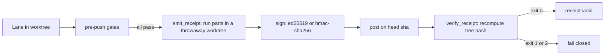

# Quickstart

This page takes about five minutes and needs no API keys. You will start the dashboard on demo data, sign
a receipt for your own checkout, and verify it offline. Then you will break the signature and watch the
verifier refuse it.

Every command output below comes from one real run on the main branch at commit `0e197fc0`, on Windows
with Git Bash. Hashes, timestamps, durations and process ids differ on your machine.

## Before you start

You need Node.js 18 or newer (`package.json:54-55`), Python 3.11 or newer (`pyproject.toml:19`) and git.
The root `package.json` has no `dependencies` key, and the receipt tools use only the Python standard
library (`tools/emit_receipt.py:3`), so there is nothing to install for this page.

Clone the repository and stay in its root for every step.

```sh
git clone https://github.com/matt82198/aesop.git
cd aesop
```

## Step 1: See the CLI

```sh
node bin/cli.js --version
node bin/cli.js --help | grep -n "^Usage:"
```

```text
0.11.0
4:Usage:
```

The version comes from `package.json:3`. The help text starts at `bin/cli.js:511` and lists the commands
used below. The same commands work as `npx @matt82198/aesop --help` without a clone.

## Step 2: Start the dashboard on demo data

```sh
node bin/cli.js dash --demo
```

```text
Launching aesop dashboard on http://localhost:8770 (DEMO DATA)

(node:10920) [DEP0190] DeprecationWarning: Passing args to a child process with shell option true can lead to security vulnerabilities, as the arguments are not escaped, only concatenated.
(Use `node --trace-deprecation ...` to show where the warning was created)
Aesop Dashboard: http://127.0.0.1:8770
Press Ctrl-C to stop
```

Open `http://127.0.0.1:8770`. The data is a seeded snapshot that labels itself as demo data. The `--demo`
flag is documented at `bin/cli.js:584`, the demo switch is activated at `ui/serve.py:32-37`, and 8770 is the
default port (`ui/config.py:67-68`). Press Ctrl-C when you are done.

## Step 3: Sign a receipt for your checkout

A receipt is a signed record of which checks ran on which tree. This step runs one part, the secret scan,
on your checkout and signs the result with HMAC-SHA256. The secret below is a demo value that anyone can
read, so the receipt proves nothing to a third party. A real key never lives in the repository
(`tools/emit_receipt.py:3`).

```sh
export AESOP_RECEIPT_HMAC_SECRET=demo-secret
python tools/emit_receipt.py --matrix secret-scan --scheme hmac-sha256 --dry-run --out /tmp/r.json
```

The first lines of the output:

```text
part secret-scan                  exit=0 tests=None 12.7s
scrub env for parts: AESOP_RECEIPT_HMAC_SECRET, AESOP_RECEIPT_KEY
conclusion=neutral head=0e197fc04976 tree=7eb45391f35f scheme=hmac-sha256
```

The signed envelope follows on standard output and is also written to `/tmp/r.json`. It ends with
`dry-run: nothing posted`, because `--dry-run` performs no network call (`python tools/emit_receipt.py
--help`). The run took about 14 seconds. The envelope has two parts. `receipt` holds `head_sha`,
`base_sha`, `tree_hash` and a `parts` list with each part's `exit_code`. `sig` holds `scheme`, `key_id` and
`value`. Note the `scrub env` line: the parts run without the signing secret in their environment.

## Step 4: Verify it offline

```sh
AESOP_RECEIPT_HMAC_SECRET=demo-secret python tools/verify_receipt.py --receipt /tmp/r.json --required secret-scan
echo "exit=$?"
```

```text
receipt VALID (head=0e197fc04976 scheme=hmac-sha256 parts=1)
exit=0
```

The verifier does not trust the tree hash in the envelope. It recomputes the hash from your checkout and
compares (`tools/verify_receipt.py:3`). It then checks the signature and that every `--required` part is
present with exit code 0. A valid receipt means the holder of the key ran those parts on that tree and
got those exit codes. It does not prove the parts were run honestly (`tools/verify_receipt.py:5-9`).

## Step 5: Break it

Verify the same file with the wrong secret.

```sh
AESOP_RECEIPT_HMAC_SECRET=wrong python tools/verify_receipt.py --receipt /tmp/r.json --required secret-scan
echo "exit=$?"
```

```text
receipt INVALID (head=0e197fc04976 scheme=hmac-sha256 parts=1)
  - signature: does not verify under hmac-sha256
exit=1
```

The verifier exits 0 for valid, 1 for invalid, and 2 when it cannot evaluate the input
(`tools/verify_receipt.py:3`). It never exits 0 when in doubt.

## What just happened



Steps 3 to 5 ran the middle of this loop by hand. In the real loop the pre-push policy runs
`check_emit_receipt` last, after every other gate has passed (`hooks/pre-push-policy.sh:4055`), and a hosted
check does the verifying. That hosted check is not required yet: the receipt gate is in a measurement
period (`docs/archive/RECEIPT-GATE.md:3-4`). A receipt is a record a gate can check. This page does not claim that
receipts replace your other CI.

## Next steps

- Verify receipts in depth: [Verify a receipt](./guides/verify-receipt.md) and the [receipt format](./reference/receipt-format.md).
- Check a hash-chained event store the same way: [Verify an event store](./guides/verify-event-store.md).
- Understand the pieces: [The receipts loop](./concepts/receipts-loop.md), [Signed receipts](./concepts/signed-receipts.md), [Event store](./concepts/event-store.md), [Stage lanes](./concepts/stage-lanes.md),
  [Crash-only operation](./concepts/crash-only.md).
- Set up a real fleet: [INSTALL.md](./INSTALL.md), [CONFIGURE.md](./CONFIGURE.md), [FIRST-WAVE.md](./FIRST-WAVE.md).
- Read the receipt gate's status and plan: [RECEIPT-GATE.md](./archive/RECEIPT-GATE.md).
- See what is public and what is not: [Provenance and evidence](./provenance/README.md).
- Find any other page: [Documentation home](./README.md).
